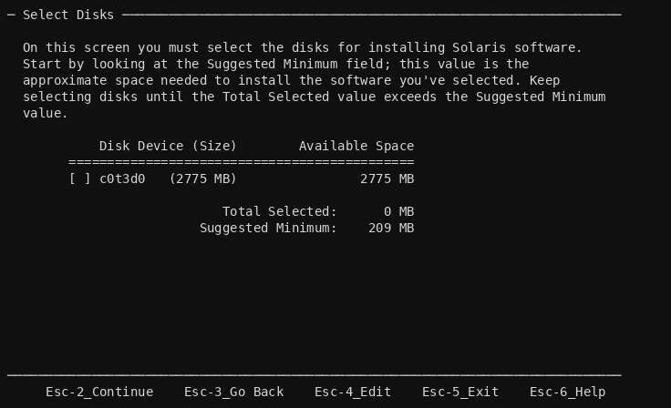
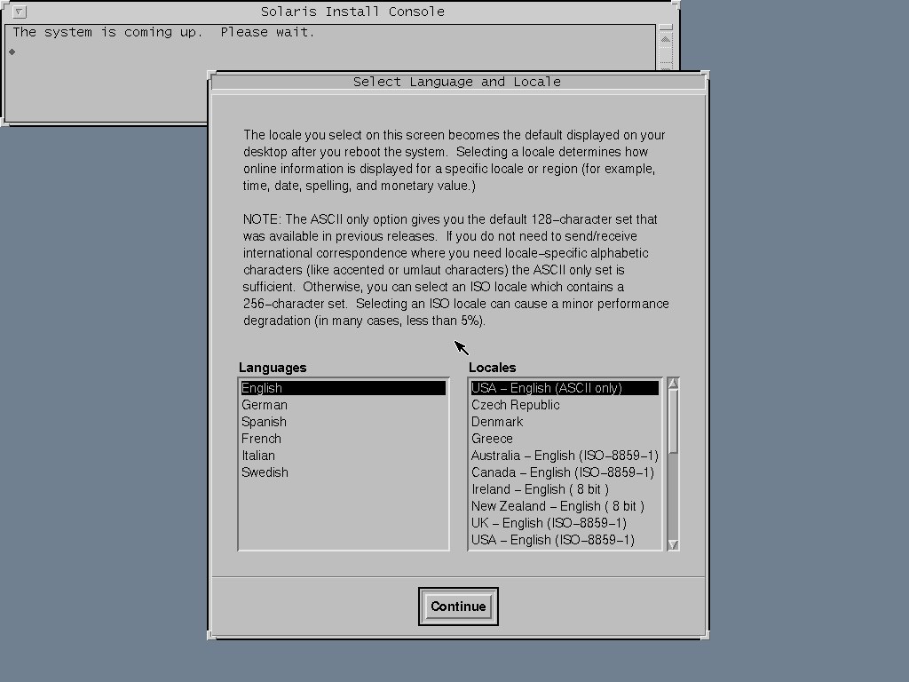

The WSH extensions add emulated SPARC and SPARC64 platforms so you can run Sun workstation operating systems such as SunOS / Solaris under Proxmox VE. SPARC emulation is experimental and sensitive to configuration — this guide collects the settings that are known to work.

:::caution
SPARC support is experimental. Only a narrow set of machine, BIOS, disk, and network combinations are known to boot. Treat these guests as best-effort, and keep them on a test host where possible.
:::

## Choosing an architecture

| Architecture | QEMU binary | Default machine |
| ------------ | ----------- | --------------- |
| sparc (32-bit) | `qemu-system-sparc` | SS-5 |
| sparc64 (64-bit) | `qemu-system-sparc64` | sun4u |

Set this in the VM's [Architecture](/reference/architecture/) panel. Selecting a SPARC architecture filters the machine, BIOS, disk, and network options to the supported subset.

## Recommended hardware layout

- **Machine** — `SS-5` for sparc, `sun4u` for sparc64 (see [Machine](/reference/machine/)).
- **BIOS / firmware** — OpenBIOS is the easiest and most reliable choice. The bundled `SS5`, `SS10`, and `SS20` PROM files are the only PROMs that are somewhat stable, and each expects a matching hardware layout (see [BIOS](/reference/bios/)).
- **Processor / memory** — a single CPU and around 512 MB of RAM for sparc32; the CPU model is fixed by the machine (see [Processors](/reference/processors/)).
- **Disk** — SCSI bus only.
- **CD-ROM** — SCSI.
- **Network** — `lance` (sparc; built into the machine and not hot-pluggable) or `sunhme` (sparc64). See [Network device](/reference/netdev/).
- **Display** — `cg3` (preferred) or `tcx` framebuffer; a serial console is also available (see [Display](/reference/display/) and [Serial port](/reference/serial/)).
- **Audio** — not currently working on SPARC.
- **USB / PCI passthrough** — not supported on SPARC.

## Installing SunOS / Solaris

1. Create a VM and set the [Architecture](/reference/architecture/) to `sparc` (or `sparc64`).
2. Confirm the machine, BIOS, disk bus, and network card match the layout above.
3. Give it a **Sun-labelled disk** (see below): the installer only lists disks that carry a Sun label.
4. Attach the installation media as a SCSI CD-ROM.
5. Make sure a network device is present **before** installing — on SunOS/Solaris the network only works if it was present at install time.
6. Boot the VM. Installation can take a long time and host CPU usage may sit near 100% for the emulated core; this is expected.

### Disks

Solaris reads the disk geometry from the disk's Sun label, and the older releases can't label an
emulated disk themselves. Start from a disk that is already labelled:

| Template | Size | Label |
| -------- | ---- | ----- |
| `sparc-SUN2.9G.raw.template.xz` | 3 GiB | `SUN2.9G cyl 2734 alt 2 hd 21 sec 99` (Solaris 2.x) |
| `sparc-Qemu9G.raw.template.xz` | 8 GiB | `QEmu8G cyl 16202 alt 2 hd 16 sec 60` (Solaris 8 needs more than 3 GB) |

The templates are in the
[proxmox repository's vm-images](https://github.com/hwinther/proxmox/tree/main/vm-images) (raw `.xz`
and qcow2). Unpack the raw template (`xz -d`) and import it as the VM's disk on SCSI target 3. To label a disk by hand
instead, use `format` with the SUN1.3G, SUN2.1G or SUN2.9G type on a 2, 2.1 or 3 GB disk, or for 8 GB a
custom type: data cylinders 16200, alternate 2, physical 16202, heads 16, sectors 60, rpm 3600.

### CD-ROM

- Disk on SCSI target 3, CD-ROM on target 6 (the SPARCstation 5 convention).
- **Solaris 2.4 and 2.5.1 need the CD to answer as a disk** (`scsi-hd`, read-only). From a CD-ROM
  device their kernel starts and then panics with `vfs_mountroot: cannot mount root`: real Sun CD-ROM
  drives used 512-byte blocks. Solaris 2.6 boots from the CD-ROM device as is. A VM's CD-ROM drive
  is always a CD-ROM device (`scsi-cd`) today; presenting it as a disk from the VM configuration is
  not supported yet.
- A CD that answers as a disk also shows up in the installer's disk list (`c0t6d0`): select only
  `c0t3d0`.
- Boot the CD from a Sun PROM with `boot cdrom`. OpenBIOS boots a CD-ROM device directly (`-boot d`);
  a CD that answers as a disk needs the full path,
  `boot /iommu@0,10000000/sbus@0,10001000/espdma@5,8400000/esp@5,8800000/sd@6,0:d`.
- Solaris 2.4 doesn't boot under OpenBIOS at all ("Unhandled Exception 0x00000009"); use `ss5.bin`.
- The Solaris 2.5.1 installer shows the year 2026 as `12` in its date screen.

### Text install on the serial console

Without a framebuffer (Display: none, a serial console) the installer runs in text mode. Choose
terminal type **3) DEC VT100**. On its screens, use **Esc then 2** for F2 (Esc-n for Fn); the arrow
keys don't work, **Ctrl-N** / **Ctrl-P** move the highlight and **Return** marks `[X]`.

The Solaris 2.6 (5/98) install, as the [sparc lab](https://github.com/hwinther/wsh-pve/tree/main/e2e/sparc)
runs it:

1. Language 0 (English), locale 0, terminal type 3 (DEC VT100).
2. Identify This System: host name, Networked **Yes**, an IP address, name service **None**, subnet,
   time zone, date and time.
3. Initial install, no client services, the software group (End User is 373 MB, Entire Distribution
   701 MB), select the disk `c0t3d0`, auto-layout.
4. Choose **Manual Reboot** at the end: the VM still boots the CD first, so an automatic reboot only
   starts the installer again. When the install is done, run `halt` (the VM powers off), set the boot
   order to the disk and start it again.
5. First boot asks for the root password, then shows `console login:`.

With 11.1 the whole End User install takes under 10 minutes on an otherwise idle host.

### Sun PROM console on the serial port

With a Sun PROM (`ss5.bin`) and no framebuffer, the PROM prints on ttya but still reads the
(emulated) Sun keyboard. Type `ttya io` at the `ok` prompt (on the keyboard, through the console's
send-key) to take input from ttya as well; the Solaris installer then runs entirely on the serial port.

### Booting the installed disk

- Sun PROMs (`ss5.bin`): `boot disk` boots SCSI target 3.
- OpenBIOS: its `disk` alias doesn't reach target 3 ("No valid state has been set by load or
  init-program"); give the full path:
  `boot /iommu@0,10000000/sbus@0,10001000/espdma@5,8400000/esp@5,8800000/sd@3,0:a`

### Graphical install

With a cg3 or tcx framebuffer the Solaris 2.6 installer is the OpenWindows GUI, driven with the mouse.

QEMU's cg3 raises its vertical-retrace interrupt only while the display is refreshed, which QEMU's VNC
server does only while a client is connected. Solaris loads the cg3 colour map on that interrupt, so a
cg3 guest that started with its console closed shows the PROM's grey palette (an almost black screen)
for the first moment after you open the console; the colours are right as soon as the display
refreshes.

### Known QEMU fixes carried in the package

- **ESP SCSI after a bus reset** (QEMU 10.1 to at least 11.1): the ESP rejected Select with ATN after
  a SCSI bus reset, and Solaris 2.5.1 looped on "gross error in esp status / undetermined selection
  failure". Fixed in `pve-qemu-kvm` 11.1.3-1+wsh1.

## Known limitations

- Audio does not work on SPARC guests.
- sparc32 is typically limited to a single CPU and ~512 MB of RAM.
- Only the `SS5`, `SS10`, and `SS20` PROM files are reasonably stable.
- sparc64 currently seems to only work with the OpenSPARC `disk.s10hw2` image.

## Testing installs automatically

`e2e/sparc` in the repository runs installs and boots unattended against the shipped QEMU, recording
the serial console and framebuffer screenshots of every step. See its
[README](https://github.com/hwinther/wsh-pve/tree/main/e2e/sparc) for the scenarios and how to write
new ones.

## Further reading

- Read [about the SPARC platform](https://wiki.qemu.org/Documentation/Platforms/SPARC) in the QEMU documentation
- See the [Guest operating systems](/guides/operating-systems/) overview for OS-specific notes
