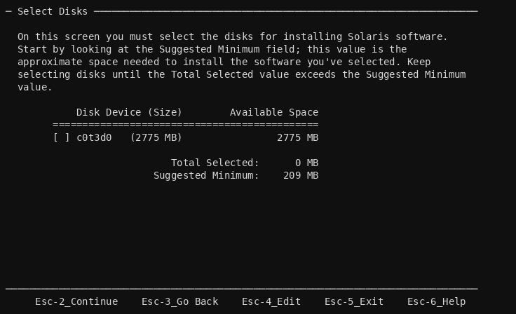

import LabCast from "../../../components/LabCast.astro";

The WSH extensions add emulated SPARC and SPARC64 platforms so you can run Sun workstation operating systems such as SunOS / Solaris under Proxmox VE. SPARC emulation is experimental and sensitive to configuration — this guide collects the settings that are known to work.

:::caution
SPARC support is experimental. Only a narrow set of machine, BIOS, disk, and network combinations are known to boot. Treat these guests as best-effort, and keep them on a test host where possible.
:::

## Choosing an architecture

| Architecture | QEMU binary | Default machine |
| ------------ | ----------- | --------------- |
| sparc (32-bit) | `qemu-system-sparc` | SS-5 |
| sparc64 (64-bit) | `qemu-system-sparc64` | sun4u |

Choose it when you create the VM (Create VM → General, with Advanced checked → vCPU Architecture);
it can't be changed later. Selecting a SPARC architecture filters the machine, BIOS, display, disk, and
network options to the supported subset.

## Supported sparc32 profiles

A sparc32 VM must match one of these combinations; the API refuses anything else (on create, on a
config change and on start) with a message naming the allowed values, and the wizard offers only these.

| Machine | BIOS | CPU | CPUs | RAM |
| ------- | ---- | --- | ---- | --- |
| SS-5 (default) | OpenBIOS (default) or `ss5.bin` | the machine's | 1 | up to 256 MB |
| SS-10 | OpenBIOS | the machine's | 1 (default) to 4 | up to 512 MB |
| SS-20 | OpenBIOS | the machine's | 1 (default) to 4 | up to 512 MB |
| SS-20 | `ss20_v2.25_rom` | `TI-SuperSparc-50` (set automatically) | 1 | up to 512 MB |

CPUs are sockets × cores (any split; Solaris sees each as a CPU module of its own, see
[More than one CPU](#more-than-one-cpu)). Display `cg3` (default), `tcx`, a serial console (serial0/serial1) or none; one
network device, `lance`.

## The sparc64 profile

A sparc64 VM has one layout, the one that was tested to boot; the API refuses anything else (on
create, on a config change and on start) with a message naming what's allowed, and the wizard and the
Hardware editors offer only it.

| Machine | BIOS | CPU | RAM | Disks and CD-ROMs | Network | Display |
| ------- | ---- | --- | --- | ----------------- | ------- | ------- |
| `sun4u` | OpenBIOS (default) | one, the machine's UltraSPARC IIi | up to 8192 MB (512 MB in the wizard) | the built-in IDE: `ide0` to `ide3` (wizard: disk `ide0`, CD-ROM `ide2`) | `sunhme` (default), `virtio`, `e1000`, `rtl8139`, `ne2k_pci`; at most four | `std` (VGA, default), `serial0`, none |

- **Boot device:** OpenBIOS boots one device and doesn't try the next, and it can't follow the boot
  paths x86 VMs get. qemu-server therefore passes the first drive of the boot order that holds
  something as the boot device: a CD-ROM with a medium boots the CD, a disk the disk. Empty CD-ROM
  drives and network devices are skipped; network boot isn't supported. A new VM gets its CD-ROM
  first in the boot order, so it boots the install CD, and once the CD is ejected (or the boot order
  puts the disk first) it boots the disk.
- **Refused:** SCSI (the LSI controller and virtio-scsi), virtio-blk and SATA disks, more than one
  CPU, a CPU type, more than 8192 MB, `sun4v` and `niagara`, more than four network devices (they
  share PCI bus B's four slots), `pcnet`, other displays, serial2/serial3, the guest agent.
  virtio-blk works as a second disk in NetBSD, but OpenBIOS can't boot it, so it isn't offered.
- **No balloon device** (OpenBIOS can't manage one; nothing reads it).
- **Existing VMs** from before the profile (SCSI disk and CD-ROM) stay readable but don't start and
  can't be changed until they match it: detach the SCSI disk and attach the volume as `ide0`, move the
  CD-ROM to `ide2`, remove a `cpu` setting. Such VMs didn't boot before either.

## Recommended hardware layout

- **Machine** — `SS-5`, `SS-10` or `SS-20` for sparc, `sun4u` for sparc64 (see [Machine](/reference/machine/)). With packages up to 11.1.3-2+wsh7, Solaris on `SS-5` runs most user programs 4-10 times slower than on `SS-20` (or `SS-10`); packages with the SS-5 TLB fix (pve-qemu patch 0017) run them equally fast on all three, existing SS-5 installs included. An `SS-20` needs its own install on that machine type.
- **BIOS / firmware** — OpenBIOS is the easiest and most reliable choice. Of the Sun PROMs, `ss5.bin` runs on SS-5 and `ss20_v2.25_rom` on SS-20 (see [BIOS](/reference/bios/)); the SS-10 PROM doesn't run on QEMU's SS-10 and isn't offered.
- **Processor / memory** — one CPU by default; up to 4 on SS-10 and SS-20 with OpenBIOS (see [More than one CPU](#more-than-one-cpu)), one on SS-5, on SS-20 with the Sun PROM and on sparc64 (QEMU's sun4u has one). RAM: at most 256 MB on SS-5 (QEMU refuses more); on SS-10 and SS-20 at most 512 MB (Solaris 2.6 panics at boot with more). The CPU model follows the machine and BIOS (see [Processors](/reference/processors/)).
- **Disk** — sparc: SCSI bus only. sparc64: the built-in IDE (see [the sparc64 profile](#the-sparc64-profile));
  OpenBIOS can't boot from SCSI or virtio.
- **CD-ROM** — sparc: SCSI. sparc64: IDE (`ide2`).
- **Network** — `lance` (sparc; built into the machine, not hot-pluggable, one per VM, with the MAC address of `net0`) or `sunhme` (sparc64). See [Network device](/reference/netdev/).
- **Display** — sparc: `cg3` (preferred) or `tcx` framebuffer; sparc64: standard VGA (`std`) with a PS/2 keyboard. A serial console is also available (see [Display](/reference/display/) and [Serial port](/reference/serial/)). Solaris only runs X on TCX when it was installed with the TCX attached or has the TCX packages added, and a change of framebuffer needs a reconfigure boot; see [cg3 or TCX](#cg3-or-tcx).
- **Audio** — SS-5 only: its built-in CS4231 (`audio0: device=cs4231,driver=none`), playback only.
  Not on SS-10/SS-20 or sparc64, and not heard in the web console; see [Sound on the SS-5](#sound-on-the-ss-5).
- **USB / PCI passthrough** — not supported on SPARC.

## More than one CPU

SS-10 and SS-20 with OpenBIOS take up to 4 CPUs (Hardware → Processors, sockets × cores; in the
wizard on the CPU tab once the machine is picked). Solaris 2.5.1 to 9 run on them as a
multiprocessor; `psrinfo` lists each one. It needs `pve-qemu-kvm` 11.1.3-2+wsh10 or later: with an
older package Solaris hangs within minutes with more than one CPU. Solaris 2.3 and 2.4 on the SS-20
(OpenBIOS, `pve-qemu-kvm` 11.1.3-2+wsh22 or later) run with 2 and 4 CPUs too: all on-line, a
parallel load on every CPU, 10 minutes of CPU and disk load on 4 CPUs without a problem; their idle
loop doesn't poll (4 idle CPUs: about 5% of a host core) without the idle halt below.

It pays for parallel work, several CPU-bound processes at once (builds, batch jobs). With a
`pve-qemu-kvm` that has the multiprocessor idle halt (pve-qemu patch `wsh/0023`, packages after
11.1.3-2+wsh13; `solaris-smp-idle`, on by default):

- An idle VM uses about 4-5% of a host core with 2 or 4 CPUs, about as much as with one CPU.
- A single job runs as fast as with one CPU; 2 CPUs finish two jobs 1.6-2.0 times sooner than one
  CPU, 4 CPUs four jobs 1.9-3.9 times sooner, depending on the program.
- Pipes, process start-up and short jobs take as long as before with 2 CPUs and less time with 4.

With an older package each vCPU keeps a host core at 100% for as long as the VM runs, idle or not,
and a single job runs slower (8-68% with 2 CPUs and 33-185% with 4, depending on the program; disk
writes too), because the idle CPUs poll. Then one CPU is faster for one interactive user. The SS-20 Sun PROM
(`ss20_v2.25_rom`) starts only the first CPU and SS-5 has one, so both stay at one. A change of the
CPU count on a running VM is applied at the next start; there is no CPU hotplug (`vcpus` and the
`cpu` hotplug option are refused).

## Sound on the SS-5

The SPARCstation 5 has a Crystal CS4231 sound chip built in. With a `pve-qemu-kvm` newer than
11.1.3-2+wsh16 it plays sound (SunOS 4.1.4's `/dev/audio`, Solaris 2.5.1 and 2.6's `audioplay`,
under OpenBIOS and the SS-5 PROM), and a program that waits for the end of a sound gets it in real
time. Turn it on with an audio device on the VM's Hardware tab (only `cs4231` is offered on SPARC)
or from the shell:

```sh
qm set <vmid> --audio0 device=cs4231,driver=none
```

Where the sound goes:

- `none`: nowhere. The chip works (programs don't hang), nobody hears it.
- `alsa`, `pa` or `pipewire`: the Proxmox node's own sound device or sound server (`pa` takes
  `server=` for a PulseAudio server elsewhere). Not tested on a real node yet.
- SPICE, the default for x86, is refused: it carries sound only to a SPICE display, and sparc32 has
  none. The web console (noVNC) has no sound either.

Without `audio0` the chip stays as it was: silent, and SunOS programs that wait for a sound to
end hang. Recording isn't done (a recording program gets no data). SS-10 and SS-20 have a
different chip (DBRI) that QEMU doesn't emulate, so `audio0` is refused there and on sparc64.
Details: `submodules/SPARC.md`, "Audio".

## Changes to a running VM

- **Applied right away:** changing, ejecting or inserting the CD-ROM's ISO; the network device's
  bridge, VLAN tag, Disconnect, rate limit and firewall; disk resize; snapshots, backups, clone and
  move disk.
- **Applied at the next start** (shown as pending): a new network model or MAC address, adding or
  removing a disk, memory, the number of CPUs. Nothing is hot-pluggable on SPARC: the lance is built into the machine,
  sun4u's IDE and PCI buses have no hotplug.

## Installing SunOS / Solaris

1. Create a VM with the [Architecture](/reference/architecture/) `SPARC (32-bit)` (or `SPARC (64-bit)`).
2. Pick a machine and BIOS from the profiles above; the wizard puts the first disk on SCSI target 3 and the CD-ROM on target 6.
3. Give it a **Sun-labelled disk** (see below): the installer only lists disks that carry a Sun label.
4. Attach the installation media as a SCSI CD-ROM.
5. Make sure a network device is present **before** installing — on SunOS/Solaris the network only works if it was present at install time.
6. Boot the VM. Installation can take a long time and host CPU usage may sit near 100% for the emulated core; this is expected.

### Disks

Solaris reads the disk geometry from the disk's Sun label, and the older releases can't label an
emulated disk themselves. Start from a disk that is already labelled:

| Template | Size | Label |
| -------- | ---- | ----- |
| `sparc-SUN2.9G.raw.template.xz` | 3 GiB | `SUN2.9G cyl 2734 alt 2 hd 21 sec 99` (Solaris 2.x) |
| `sparc-Qemu9G.raw.template.xz` | 8 GiB | `QEmu8G cyl 16202 alt 2 hd 16 sec 60` (Solaris 8 needs more than 3 GB; Solaris 2.6 and 7 install on it too) |

The templates are in the
[proxmox repository's vm-images](https://github.com/hwinther/proxmox/tree/main/vm-images) (raw `.xz`
and qcow2). Unpack the raw template (`xz -d`) and import it as the VM's disk on SCSI target 3. To label a disk by hand
instead, use `format` with the SUN1.3G, SUN2.1G or SUN2.9G type on a 2, 2.1 or 3 GB disk, or for 8 GB a
custom type: data cylinders 16200, alternate 2, physical 16202, heads 16, sectors 60, rpm 3600.

### CD-ROM

- Disk on SCSI target 3, CD-ROM on target 6 (the SPARCstation 5 convention).
- **Solaris 2.3 to 2.5.1 need the CD to answer as a disk** (`scsi-hd`, read-only). From a CD-ROM
  device their kernel starts and then panics with `vfs_mountroot: cannot mount root` (2.3, 2.4,
  2.5.1) or hangs (2.5): real Sun CD-ROM drives used 512-byte blocks. Solaris 2.6 boots from the
  CD-ROM device as is. Add `cd_as_disk=1`
  to the CD-ROM drive to present it as a read-only disk (needs qemu-server with this option):

  ```sh
  qm set 100 --scsi6 local:iso/solaris_2.5.1_1197.iso,media=cdrom,cd_as_disk=1
  ```

  The drive stays a CD-ROM drive in PVE: read only, not backed up, the ISO is never copied or
  deleted, and ejecting it (`none`) leaves an empty CD-ROM drive. Only sparc32 (`arch: sparc`) SCSI
  CD-ROMs with an ISO take the option; anything else is refused. A medium change while the VM runs
  waits for the next start (a disk has no removable medium). The web UI keeps the option when you
  change or eject the medium, but has no field for it: set it with `qm set` or the API. Before the
  option existed the workaround was the ISO copied into a raw disk image of the VM, attached
  read-only on target 6 (`scsi6: local:100/vm-100-disk-1.raw,ro=1,backup=0`); that still works.
- A CD that answers as a disk also shows up in the installer's disk list (`c0t6d0`): select only
  `c0t3d0`.
- Boot the CD from a Sun PROM with `boot cdrom`. OpenBIOS boots a CD-ROM device directly (`-boot d`);
  a CD that answers as a disk needs the full path,
  `boot /iommu@0,10000000/sbus@0,10001000/espdma@5,8400000/esp@5,8800000/sd@6,0:d`.
- Solaris 2.2, 2.3 and 2.4 boot under OpenBIOS with `pve-qemu-kvm` 11.1.3-2+wsh22 or later
  (OpenBIOS patches 0019-0022); with an older package OpenBIOS stops right after their boot block
  ("Unhandled Exception 0x00000009"), and only the Sun PROMs boot 2.3 and 2.4 (`ss5.bin` on the SS-5,
  `ss20_v2.25_rom` on the SS-20; 2.3 Edition II is the first release for both). 2.2 runs on the
  SS-10 only (its only supported sun4m machine). 2.5 and 2.5.1 boot under OpenBIOS too.
- Solaris 2.3 and 2.4 on the SS-20 with OpenBIOS run with 2 or 4 CPUs (every CPU on-line, a
  parallel load spread over all of them); idle CPUs don't keep the host busy.
- The Solaris 2.5.1 installer shows the year 2026 as `12` in its date screen; 2.3 and 2.4 show it
  as `1912` and refuse it: type the 4-digit year over it.
- Solaris 2.2's and 2.3's installers ask one question per screen (Return answers, Ctrl-N/Ctrl-P
  move in a menu) and offer Quick Install; they reboot by themselves at the end. On the installed
  2.3, `init 5` reboots (to the Sun PROM's `ok`, or OpenBIOS boots the disk again) instead of
  powering off: stop the VM there.
- SunOS 4.1.3_U1B installs like 4.1.4 (OpenBIOS, 64 MB while the CD's kernel runs) on the SS-5,
  SS-10 and SS-20; its CD image needs no conversion. The original SunOS 4.1.3 and Solaris 2.1
  don't boot on any machine and firmware QEMU and the package offer (their only supported machine
  is the SS-10, whose Sun PROM doesn't run on QEMU; 2.1 gets through its device configuration under
  OpenBIOS, then QEMU stops); details in `submodules/SPARC.md`, "Older Sun releases on sun4m".

### Text install on the serial console

Without a framebuffer (Display: none, a serial console) the installer runs in text mode. Choose
terminal type **3) DEC VT100**. On its screens, use **Esc then 2** for F2 (Esc-n for Fn); the arrow
keys don't work, **Ctrl-N** / **Ctrl-P** move the highlight and **Return** marks `[X]`.



The Solaris 2.6 (5/98) install, as the [sparc lab](https://github.com/hwinther/wsh-pve/tree/main/e2e/sparc)
runs it:

1. Language 0 (English), locale 0, terminal type 3 (DEC VT100).
2. Identify This System: host name, Networked **Yes**, an IP address, name service **None**, subnet,
   time zone, date and time.
3. Initial install, no client services, the software group (End User is 373 MB, Entire Distribution
   701 MB), select the disk `c0t3d0`, auto-layout.
4. Choose **Manual Reboot** at the end: the VM still boots the CD first, so an automatic reboot only
   starts the installer again. When the install is done, run `halt` (the VM powers off), set the boot
   order to the disk and start it again.
5. First boot asks for the root password, then shows `console login:`.

With 11.1 the whole End User install takes under 10 minutes on an otherwise idle host. The lab's
recording of it, its 10 minutes in two (pauses cut to a second, played three times as fast; the
marks on the progress bar are its steps):

<LabCast
  src="/recordings/sol26-install-ss5.cast"
  caption="Solaris 2.6 (5/98) End User install on the serial console: SS-5, OpenBIOS, QEMU 11.1"
  poster="npt:0:20"
/>

More recordings, including a cg3 boot, are on [SPARC lab recordings](/guides/sparc-recordings/).

### Sun PROM console on the serial port

With a Sun PROM (`ss5.bin`) and no framebuffer (Display: a serial port or none), qemu-server starts
QEMU with `-nographic`, which also leaves out the Sun keyboard: the PROM reports `SPARCstation 5, No
Keyboard` and uses ttya for input and output, so `qm terminal` is the whole console (checked with
`vga: serial0`). A QEMU started by hand with `-vga none` but without `-nographic` keeps the keyboard:
the PROM then prints on ttya but reads the keyboard, and `ttya io` typed on the keyboard at the `ok`
prompt moves input to ttya as well.

### Booting the installed disk

- Sun PROMs (`ss5.bin`): `boot disk` boots SCSI target 3.
- OpenBIOS: with the boot order set to the disk it boots SCSI target 3 by itself (`boot disk`
  works too). The package carries an OpenBIOS fix for this; the stock OpenBIOS in QEMU 9.2 and
  later has no `disk` alias and stops with "No valid state has been set by load or
  init-program". With that one, give the full path:
  `boot /iommu@0,10000000/sbus@0,10001000/espdma@5,8400000/esp@5,8800000/sd@3,0:a`

### Stop-A and the PROM prompt

Stop-A (L1-A: hold Stop, press A) on the keyboard of a framebuffer console stops a running Solaris
or SunOS at the firmware prompt, as on a Sun: OpenBIOS prints `Type  'go' to resume` and its `0 >`
prompt over whatever was on the screen. Type `go` to give the system back where it was, or `boot` to
reset the VM and boot again. Send the chord from the VM's Monitor (`sendkey stop-a`) or with `qm
sendkey <vmid> stop-a`. NetBSD's kernel enters its own debugger (`db>`) instead; `c` continues. With
the console on a serial port there is no Stop-A: Solaris takes a break on the serial line for it,
which the PVE serial console can't send (and a break sent to QEMU some other way hangs Solaris on
that port).

With `pve-qemu-kvm` 11.1.3-2+wsh10 and earlier, OpenBIOS powered the VM off at Stop-A, losing
whatever the guest hadn't written to disk. The Sun PROM (`ss5.bin`) always stopped at `ok`.

### Graphical install

With a cg3 or tcx framebuffer the Solaris 2.6 installer is the OpenWindows GUI, driven with the mouse.


QEMU's cg3 raises its vertical-retrace interrupt only while the display is refreshed, which QEMU's VNC
server does only while a client is connected. Solaris loads the cg3 colour map on that interrupt, so a
cg3 guest that started with its console closed shows the PROM's grey palette (an almost black screen)
for the first moment after you open the console; the colours are right as soon as the display
refreshes.

### cg3 or TCX

Both run the Solaris 2.6 desktop (CDE) on SS-5 (OpenBIOS or `ss5.bin`), SS-10 and SS-20 with
OpenBIOS. Keep **cg3** unless you want 24-bit colour:

- **cg3** (the default): 8-bit colour, works on any installed Solaris, and draws text 4 to 8 times
  faster than TCX under QEMU (TCX's drawing engine is emulated register by register, which costs more
  than plain memory writes).
- **TCX**: 1024x768 only, 8-bit; QEMU can also run it with 24-bit colour, but the VM settings don't
  offer that yet. Solaris needs its TCX packages, which the installer only adds when it sees a TCX:
  a system installed with cg3 or on the serial console boots on TCX with `NOTICE: Can't find driver
  for console framebuffer` and no desktop (`/var/dt/Xerrors`: `Graphics Adapter device /dev/fb is of
  unknown type`). Add them from the install CD and reconfigure:

  ```sh
  pkgadd -d /cdrom/cdrom0/s0/Solaris_2.6/Product SUNWtcx.m SUNWtcxow SUNWtcxu
  touch /reconfigure
  ```

- **Switching** between cg3 and TCX on an installed Solaris: run `touch /reconfigure` before the change,
  or boot once with `boot -r`. Without that `/dev/fb` still points at the old framebuffer and the
  desktop doesn't start (`/dev/fb: No such device or address`).

### Known QEMU fixes carried in the package

- **ESP SCSI after a bus reset** (QEMU 10.1 to at least 11.1): the ESP rejected Select with ATN after
  a SCSI bus reset, and Solaris 2.5.1 looped on "gross error in esp status / undetermined selection
  failure". Fixed in `pve-qemu-kvm` 11.1.3-1+wsh1.

## Installing Red Hat Linux 6.2

Red Hat Linux 6.2 for SPARC (kernel 2.2.14) installs on the SS-5 and SS-20 profiles with OpenBIOS
and a serial console (`vga: serial0`): its 32-bit kernel drives the ESP disk and CD-ROM, the lance
NIC (`eth0`) and the serial port (`ttyS0`) as they are, and `poweroff` powers the VM off.

- **Boot the CD by device path.** With the disk on target 3 first, OpenBIOS stops at `0 >`; the
  CD's boot loader is not in slice `d`, so boot the whole device:
  `boot /iommu/sbus/espdma/esp/sd@6,0`. At SILO's `boot:` type `linux` (or `text`).
- **Give the disk a label first.** On a blank disk the installer asks to initialize it; a disk
  with a Sun label (the [disk templates](#disks)) skips that question.
- **Make `/boot` the first partition**, small (32 MB is plenty), from cylinder 0. SILO's first stage
  loads its second stage through the PROM, which can't read that far into the disk: with one big
  `/` the installed disk stops after SILO's `S`, under OpenBIOS and the SS-5 PROM alike.
- **SILO on the "first sector of boot partition"** (the installer's default) is right on a Sun
  label: that sector is the disk's boot block. The installed disk then boots by itself.

[Lab install targets](/guides/lab-install/) installs it unattended (`redhat62-ss5`,
`redhat62-ss20`: kickstart from a small answer CD, about six minutes).

## Installing Debian GNU/Linux 4.0

Debian 4.0r9 "etch" (kernel 2.6.18), the last Debian release for sun4m, installs from its netinst
CD on the SS-5 and SS-20 profiles with OpenBIOS and a serial console (`vga: serial0`), fetching its
packages from `archive.debian.org`.

- **It needs `pve-qemu-kvm` 11.1.3-2+wsh20 or later** (the ESP fix `wsh/0038`). Linux 2.6.18's ESP
  driver negotiates synchronous transfers with a multi-byte message, which QEMU's ESP mishandled:
  without the fix the kernel takes the disk and CD-ROM offline and the installer finds no CD.
- **Boot the CD by device path** as for Red Hat: `boot /iommu/sbus/espdma/esp/sd@6,0`, then
  `install` at SILO's `boot:`.
- **Hide the floppy drive.** QEMU's sun4m always has an empty one; when the partitioner scans it,
  2.6.18's floppy driver can crash and the installer stops at "Scanning disks". Remove `/dev/fd0`
  in the installer's shell before partitioning (the lab's preseed loader does it with a udev rule).
- **Start from a blank disk** and let the partitioner write the Sun label; put a small `/boot`
  first, for the same SILO reason as Red Hat.
- **The archive's signing key expired in 2012.** The lab boots the installer with
  `debian-installer/allow_unauthenticated` preseeded, which installs without checking the
  archive's signature (an install without it wasn't tried). Leave the security mirror out; etch's
  security updates are no longer served.

[Lab install targets](/guides/lab-install/) installs it unattended (`debian40-ss5`,
`debian40-ss20`: preseed from a small answer CD, with `--apt-proxy` for a package cache).

## NeXTSTEP 3.3 and OPENSTEP 4.2

NeXTSTEP 3.3 and OPENSTEP 4.2 for Mach (the OPENSTEP 4.2 "Intel" User CD also carries the SPARC
version) **don't install with the published `pve-qemu-kvm`** (11.1.3-2+wsh22): the CD boots, but the
install hangs while the kernel mounts its root, prepares the disk or copies files, the CPU spinning in the
guest's SCSI driver. QEMU's ESP signals a finished command earlier than real hardware can, and NeXT's
driver deadlocks on that. The fix, pve-qemu patch `wsh/0040`, delays the ESP's interrupt on sun4m
by 500 µs; in the lab a QEMU built with it installs both on an SS-5 and boots them to the Workspace.
It isn't in a package yet. Details: `submodules/SPARC.md`, "NeXTSTEP 3.3 and OPENSTEP 4.2".

What works with that fix, for when it is published:

- **SS-5 with `bios: ss5.bin` and `vga: tcx`.** NeXT has no cg3 driver; its TCX driver runs QEMU's
  8-bit TCX at 1024x768. OpenBIOS boots the CD but not the installed disk, so use the Sun PROM
  throughout. A blank disk of 1-3 GB.
- **The whole install is on the framebuffer** (the VNC console) with the keyboard and mouse: a text
  stage from the CD (language, the disk, copying the base system; 2-4 minutes), then from the disk
  Configure (click Save) and the Installer's package list (6-15 minutes), then the language panel and
  the Workspace, logged in as `me` without a password.
- **At each disk boot:** in the Sun PROM, `setenv diag-switch? false` once, then `boot disk`; at
  NeXT's `boot:` prompt type `-v` within 10 seconds (its boot graphics stop the PROM with `Data
  Access Error` on this TCX); press Control-C when it waits for a network configuration server.
- **Not the SS-20:** the CD stage runs there, but neither OpenBIOS nor `ss20_v2.25_rom` (QEMU stops
  with a trap) boots the installed disk.

The lab lists them as `nextstep33-ss5` and `openstep42-ss5` in its catalogue, not yet installable
([Lab install targets](/guides/lab-install/)).

## sparc64 (sun4u)

Tested with the `pve-qemu-kvm` 11.1.3-2+wsh7 package (details: `submodules/SPARC.md`, "sparc64"):

| Guest | Result |
| ----- | ------ |
| NetBSD 11.1 (and 9.3) | CD boots to the installer on the serial console or the VGA screen; NetBSD 11.1 installs (about 8 minutes) and the installed system boots, gets a DHCP address and powers the VM off |
| OpenBSD 8.0 | with 11.1.3-2+wsh22 or later (OpenBIOS patch 0023): installs from `install80.iso` (about 10 minutes; `wsh-lab install openbsd80-sun4u` does it through Proxmox) and the installed system boots to its login, gets its address on `hme0` (static or DHCP) and powers off with `halt -p`. Keep ntpd off (`rcctl disable ntpd`; the lab target does): with a reachable NTP server the IDE disk timed out (`wd0: timeout`) after ntpd slewed the clock, in 5 of 6 boots. Without ntpd it happens too, rarely (once in five installs, once in several boots with heavy disk use), and then the guest stops answering: stop and start the VM. Before +wsh22 the installed kernel stops in the firmware (`Unhandled Exception 0x30`: the firmware overwrote a value on the kernel's stack) |
| Debian 12 (ports netinst) | the installer boots and partitions; installing the base system fails (a program crashes while unpacking) |
| Solaris 10 1/13 | with 11.1.3-2+wsh13 or later: installs to the IDE disk (about 80 minutes; `wsh-lab install sol10-sun4u` does it through Proxmox) and the installed system boots, gets its address and powers off; no reboot (see below) |
| Solaris 2.5.1-9 | doesn't boot on sun4u with OpenBIOS (stops in the boot block or panics early in the kernel) |
| Tribblix m34 (illumos) | with pve-qemu-kvm 11.1.3-2+wsh20 or later (OpenBIOS patches 0016 and 0017, QEMU `wsh/0036`): the live CD boots, installs to the IDE disk with its own installer, and the installed system boots (see [Tribblix (illumos)](#tribblix-illumos)) |

What works is what [the sparc64 profile](#the-sparc64-profile) allows: the machine's built-in **IDE**
for disks and the CD-ROM (OpenBIOS boots only from there), **`sunhme`** (NetBSD also drives `virtio`,
`e1000`, `rtl8139` and `ne2k_pci`), standard VGA or a serial console, one CPU, up to 8 GB of RAM. The
LSI SCSI controller and virtio-scsi don't work (no firmware driver, and the guests' drivers time out
or fail). A VM created by the wizard with the NetBSD 11.1 CD boots it to the installer through Proxmox
by itself (tested in the sparc lab's `pve` matrix, serial console).

More than 3 GB needs pve-qemu-kvm 11.1.3-2+wsh16 or later: its OpenBIOS carries patches 0013-0015.
With older firmware 4 GB stops NetBSD right after its loader and from about 4.3 GB the firmware itself
stops. With the patches NetBSD 11.1 ran with 4, 6 and 8 GB and Solaris 10 1/13 with 4 and 8 GB in the
sparc lab (QEMU started directly, not through Proxmox), each using most of that memory without
errors. 8 GB is the largest size tested, so the profile stops there.

### Installing NetBSD

1. Create VM, General: Advanced, vCPU Architecture **SPARC (64-bit)**. OS: the NetBSD sparc64 ISO,
   type Other. Keep the defaults on the other tabs (disk on `ide0`, 512 MB, `sunhme`); for a serial
   console instead of the VGA screen, add a serial port (`serial0: socket`) and set Display to Serial
   terminal 0 afterwards.
2. Start it: OpenBIOS boots the CD, NetBSD asks for the terminal type (`vt100` on the serial console),
   and sysinst starts. Install to `wd0`.
3. At the end, power off (`halt -p`), then eject the CD (Hardware → CD/DVD Drive → Do not use any
   media) or put `ide0` first in the boot order. The next start boots the installed disk.

Expect one host core at 100% for as long as the VM runs: NetBSD doesn't idle on sun4u.

### Solaris 10

Solaris 10 1/13 installs to the IDE disk and the installed system boots, with `pve-qemu-kvm`
11.1.3-2+wsh13 or later (it ships the patched `openbios-sparc64` and the IDE interrupt fix). Measured
in the sparc lab with QEMU started directly, in the same layout as the sparc64 profile (disk on the
primary and DVD on the secondary IDE channel, `sunhme`, serial console, 1024 MB): 2 of 2 installs
completed, about 80 minutes each. Through Proxmox the whole install is automated: `wsh-lab install
sol10-sun4u --vmid N --check` (the [lab install targets](/guides/lab-install/)) does the steps
below on a VM it creates with the sparc64 profile (a blank 16 GB disk on `ide0`, the DVD on `ide2`,
`sunhme`, `vga: serial0`, 1024 MB), with a static address, and checks the result: 3 of 3 runs passed (one more failed in the first boot on a bug that is fixed now, one stopped with a panic while the DVD booted, which the tool now retries once) in the
PVE test container with the published packages, about 110 minutes each (install about 81 minutes,
first boot about 19, check 8-9).

1. Create the VM as for NetBSD with the Solaris 10 1/13 SPARC DVD, 1024 MB, a disk of 16 GB (the
   default software group needs about 5.3 GB) and a serial console (`serial0: socket`, Display:
   Serial terminal 0).
2. Start it and open the serial console. The DVD boots in about 3 minutes and asks for the language
   and the terminal type (`0`, then `3` for DEC VT100). The installer's screens use Esc then a digit
   for the function keys (Esc 2 is F2, Continue), Ctrl-N/Ctrl-P to move, Return to mark `[X]`. Use
   DHCP for `hme0`, or a static address (host name, IP address, subnet, netmask, default route),
   mark a time zone, set the root password, choose CD/DVD as the media, select the disk `c0t0d0`.
   The package copy takes about an hour.
3. At the end the installer tries to reboot and stops with `prom_reboot: reboot call returned!`
   (the firmware has no working reboot for Solaris yet). Stop the VM, eject the DVD or put `ide0`
   first in the boot order, and start it again.
4. The first boot takes about 14 minutes (it imports its service descriptions), asks for the
   keyboard layout (F2 keeps US-English) and comes to `console login:`. `hme0` gets its address by
   DHCP or has the static one. `init 5` powers the VM off (it takes 3 to 6 minutes). Don't use `reboot` or `init 6`: they go through the same
   firmware call as the installer's reboot. Stop and start the VM instead.

The guest's system MAC address (the one in the IDPROM, which Solaris and NetBSD use for `hme0`) is
the MAC address of the VM's first `sunhme` network device, as set in the VM's hardware, so DHCP
reservations and firewall rules keyed on it match. The host id (`hostid`) is made from the same
address, so it changes when the MAC address does. With pve-qemu-kvm packages before this change
every sun4u guest had 52:54:00:12:34:56 and Solaris host id `80123456`; after the update an
existing VM comes up with its own MAC and a new host id (intended, but software licensed to the old
host id needs a new key). Details: `submodules/SPARC.md`, "The sun4u system MAC".

### Tribblix (illumos)

Tribblix m34 for SPARC (`tribblix-sparc-0m34.iso` from tribblix.org), the newest illumos release
for SPARC, needs pve-qemu-kvm 11.1.3-2+wsh20 or later: two OpenBIOS fixes (repository patches 0016
and 0017: the firmware's client interface with interrupts off, and the 64-bit FCode tokens that the
ZFS boot block uses) and a QEMU fix for its clock (`wsh/0036`). With older packages the live CD
stops or hangs on most boots, a ZFS root disk doesn't boot, and the guest's clock stopped for good
in about one of three long runs. With the fixes, measured in the sparc lab and through Proxmox:

1. Create the VM as for NetBSD with the Tribblix ISO, 2048 MB, an 8 GB disk and a serial console
   (`serial0: socket`, Display: Serial terminal 0).
2. The live CD boots by itself and imports its service descriptions, which takes about 45 minutes
   under emulation; it asks for the keyboard layout (Return for US-English) and comes to `tribblix
   console login:`. Log in as `root` (password `tribblix`). The disk is `c1t0d0`.
3. Take the network down (`ipadm delete-if hme0`; otherwise the installer fetches some packages
   from the internet) and install with the CD's installer: `cd /root; ./live_install.sh -G c1t0d0`
   (Tribblix's default, a ZFS root pool; about an hour). The fault manager marks the disk DEGRADED
   during the copy (I/O that ZFS had to retry on the emulated IDE disk; no data errors); `zpool clear
   rpool` on the installed system should remove the mark (not checked yet).
4. `init 5`, eject the CD (or put `ide0` first in the boot order) and start the VM: the installed
   system's first boot imports the service descriptions again (99 of them; `console login:` after
   about 70 minutes). Only the first boot does that: later boots reach `console login:` in 12-14
   minutes. Change root's password and lock the live CD's `jack` account. Don't use `reboot`: stop
   and start the VM. `init 5` itself takes several minutes.

`wsh-lab install tribblix-m34-sun4u --vmid N --check` automates this on a VM it creates with the
sparc64 profile, with a known root password and a static address. Several services time out on the
way under emulation (`svc.startd` kills them); the system comes up anyway. Through Proxmox it took
4.3 hours (install 141 minutes, first boot 89, check 26). Details: `submodules/SPARC.md`, "Tribblix
on sun4u".

## Known limitations

- Sound only on SS-5 (playback, not in the web console); none on SS-10/SS-20 or sparc64 (see
  [Sound on the SS-5](#sound-on-the-ss-5)).
- sparc32: more than one CPU only on SS-10/SS-20 with OpenBIOS (up to 4), and the idle halt with
  more than one CPU only for Solaris 2.5.1-9 (NetBSD's and Solaris 2.3/2.4's MP kernels idle by
  themselves); 256 MB on SS-5,
  512 MB on SS-10/SS-20.
- Of the Sun PROMs only `ss5.bin` (SS-5) and `ss20_v2.25_rom` (SS-20, with `TI-SuperSparc-50`) are
  supported; the SS-10 PROM doesn't run on QEMU's SS-10.
- No framebuffer resolution option: cg3 runs at 1024x768. TCX is always 1024x768, 8-bit (no 24-bit option).
- SS-20 with `ss20_v2.25_rom`: Solaris 2.6 panics at boot (`BAD TRAP ... kernel read fault at
  addr=0x0`) with the console on a framebuffer (cg3 or TCX). Use a serial console with that
  firmware, or OpenBIOS.
- Moving the mouse pointer in the Solaris desktop didn't work in the lab's tests (keyboard input
  does); not yet checked from a VNC console.
- NeXTSTEP 3.3 and OPENSTEP 4.2 hang during their install with the published package (an ESP
  interrupt timing problem; see [NeXTSTEP 3.3 and OPENSTEP 4.2](#nextstep-33-and-openstep-42)).
- The architecture can't be changed after the VM is created.
- A Solaris disk installed on SS-5 doesn't boot on SS-10/SS-20: install on the machine type the VM
  will keep.
- sparc64: NetBSD and OpenBSD 8.0 install and run (OpenBSD with ntpd off); the Debian installer
  starts but its install doesn't end in a working system; Solaris 10 installs and boots, but doesn't reboot (see
  [Solaris 10](#solaris-10)); older Solaris releases don't boot on sun4u. One layout only (see
  [the sparc64 profile](#the-sparc64-profile)); no network boot.

## Testing installs automatically

`e2e/sparc` in the repository runs installs and boots unattended against the shipped QEMU, recording
the serial console and framebuffer screenshots of every step, the console as a terminal recording and
the framebuffer as a short video ([examples](/guides/sparc-recordings/)). See its
[README](https://github.com/hwinther/wsh-pve/tree/main/e2e/sparc) for the scenarios and how to write
new ones.

### Provisioning a Solaris VM with the lab

For a finished VM with known login details, `lab.py install sol26-ss5 --vmid 120` (or `sol26-ss20`)
does everything below in one command, from the tested CD on the node's storage: see
[Lab install targets](/guides/lab-install/). With a second disk on `/usr/local` it can also add the GNU
packages of a local package CD for Solaris 2.6 after the install (2.6 and 7) (`--post-install sun26gnu`; the CD is
not published), and set up `PATH` and bash for the user (`--local-env`).

The same scenarios can install a VM that Proxmox VE runs. On the node (the lab needs `python3-pyte`,
`python3-pil`, `tesseract-ocr` and `fonts-dejavu-core`), create the VM with a serial console, the
unpacked disk template imported as its disk and the CD attached, then run the install and the first
boot against its VMID:

```sh
xz -dk sparc-SUN2.9G.raw.template.xz
qm create 100 --arch sparc --name sol26 --memory 256 --ostype solaris --net0 lance,bridge=vmbr0 \
  --serial0 socket --vga serial0 \
  --scsi3 local:0,import-from=/root/sparc-SUN2.9G.raw.template,format=raw \
  --scsi6 local:iso/solaris_2.6_598_sparc.iso,media=cdrom
python3 lab.py run scenarios/solaris-install-serial.py --pve 100 --out /root/runs/install
python3 lab.py run scenarios/solaris-boot-disk.py --pve 100 --out /root/runs/boot
```

The lab starts the VM with `qm start`, types on its serial socket and uses the monitor (QMP) for keys
and screenshots; the install (End User, host name `solaris`, no root password) ends powered off, and
the first boot answers the root password questions and logs in. While the lab runs it owns the serial
console: close `qm terminal` and the web console first. Each run leaves `index.html` with every step.

## Further reading

- Read [about the SPARC platform](https://wiki.qemu.org/Documentation/Platforms/SPARC) in the QEMU documentation
- See the [Guest operating systems](/guides/operating-systems/) overview for OS-specific notes
