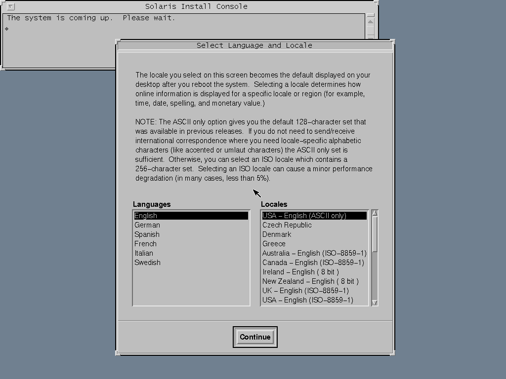

import LabCast from "../../../components/LabCast.astro";

The WSH extensions add emulated SPARC and SPARC64 platforms so you can run Sun workstation operating systems such as SunOS / Solaris under Proxmox VE. SPARC emulation is experimental and sensitive to configuration — this guide collects the settings that are known to work.

:::caution
SPARC support is experimental. Only a narrow set of machine, BIOS, disk, and network combinations are known to boot. Treat these guests as best-effort, and keep them on a test host where possible.
:::

## Choosing an architecture

| Architecture | QEMU binary | Default machine |
| ------------ | ----------- | --------------- |
| sparc (32-bit) | `qemu-system-sparc` | SS-5 |
| sparc64 (64-bit) | `qemu-system-sparc64` | sun4u |

Choose it when you create the VM (Create VM → General, with Advanced checked → vCPU Architecture);
it can't be changed later. Selecting a SPARC architecture filters the machine, BIOS, display, disk, and
network options to the supported subset.

## Supported sparc32 profiles

A sparc32 VM must match one of these combinations; the API refuses anything else (on create, on a
config change and on start) with a message naming the allowed values, and the wizard offers only these.

| Machine | BIOS | CPU | RAM |
| ------- | ---- | --- | --- |
| SS-5 (default) | OpenBIOS (default) or `ss5.bin` | the machine's | up to 256 MB |
| SS-10 | OpenBIOS | the machine's | up to 512 MB |
| SS-20 | OpenBIOS | the machine's | up to 512 MB |
| SS-20 | `ss20_v2.25_rom` | `TI-SuperSparc-50` (set automatically) | up to 512 MB |

Always one CPU. Display `cg3` (default), `tcx`, a serial console (serial0/serial1) or none; one
network device, `lance`.

## Recommended hardware layout

- **Machine** — `SS-5`, `SS-10` or `SS-20` for sparc, `sun4u` for sparc64 (see [Machine](/reference/machine/)). For Solaris 2.6, `SS-20` (or `SS-10`) with OpenBIOS runs user programs about 9 times faster than `SS-5` on the same host (disk and boot times are the same); it needs its own install on that machine type.
- **BIOS / firmware** — OpenBIOS is the easiest and most reliable choice. Of the Sun PROMs, `ss5.bin` runs on SS-5 and `ss20_v2.25_rom` on SS-20 (see [BIOS](/reference/bios/)); the SS-10 PROM doesn't run on QEMU's SS-10 and isn't offered.
- **Processor / memory** — one CPU for sparc32 and sparc64 (QEMU's sun4u has one). RAM: at most 256 MB on SS-5 (QEMU refuses more); on SS-10 and SS-20 at most 512 MB (Solaris 2.6 panics at boot with more). QEMU emulates up to 4 CPUs on SS-10/SS-20, but Solaris 2.6 with more than one CPU hangs within minutes, so the VM gets one. The CPU model follows the machine and BIOS (see [Processors](/reference/processors/)).
- **Disk** — sparc: SCSI bus only. sparc64: the built-in IDE (see [sparc64](#sparc64-sun4u)); OpenBIOS
  can't boot the SCSI controller the wizard offers.
- **CD-ROM** — sparc: SCSI. sparc64: IDE (`ide2`).
- **Network** — `lance` (sparc; built into the machine, not hot-pluggable, one per VM, with the MAC address of `net0`) or `sunhme` (sparc64). See [Network device](/reference/netdev/).
- **Display** — sparc: `cg3` (preferred) or `tcx` framebuffer; sparc64: standard VGA (`std`) with a PS/2 keyboard. A serial console is also available (see [Display](/reference/display/) and [Serial port](/reference/serial/)). Solaris only runs X on TCX when it was installed with the TCX attached or has the TCX packages added, and a change of framebuffer needs a reconfigure boot; see [cg3 or TCX](#cg3-or-tcx).
- **Audio** — not currently working on SPARC.
- **USB / PCI passthrough** — not supported on SPARC.

## Changes to a running VM

- **Applied right away:** changing, ejecting or inserting the CD-ROM's ISO; the network device's
  bridge, VLAN tag, Disconnect, rate limit and firewall; disk resize; snapshots, backups, clone and
  move disk.
- **Applied at the next start** (shown as pending): a new network model or MAC address, adding or
  removing a disk, memory. Nothing is hot-pluggable on SPARC: the lance is built into the machine
  and sun4u's PCI buses have no hotplug.

## Installing SunOS / Solaris

1. Create a VM with the [Architecture](/reference/architecture/) `SPARC (32-bit)` (or `SPARC (64-bit)`).
2. Pick a machine and BIOS from the profiles above; the wizard puts the first disk on SCSI target 3 and the CD-ROM on target 6.
3. Give it a **Sun-labelled disk** (see below): the installer only lists disks that carry a Sun label.
4. Attach the installation media as a SCSI CD-ROM.
5. Make sure a network device is present **before** installing — on SunOS/Solaris the network only works if it was present at install time.
6. Boot the VM. Installation can take a long time and host CPU usage may sit near 100% for the emulated core; this is expected.

### Disks

Solaris reads the disk geometry from the disk's Sun label, and the older releases can't label an
emulated disk themselves. Start from a disk that is already labelled:

| Template | Size | Label |
| -------- | ---- | ----- |
| `sparc-SUN2.9G.raw.template.xz` | 3 GiB | `SUN2.9G cyl 2734 alt 2 hd 21 sec 99` (Solaris 2.x) |
| `sparc-Qemu9G.raw.template.xz` | 8 GiB | `QEmu8G cyl 16202 alt 2 hd 16 sec 60` (Solaris 8 needs more than 3 GB) |

The templates are in the
[proxmox repository's vm-images](https://github.com/hwinther/proxmox/tree/main/vm-images) (raw `.xz`
and qcow2). Unpack the raw template (`xz -d`) and import it as the VM's disk on SCSI target 3. To label a disk by hand
instead, use `format` with the SUN1.3G, SUN2.1G or SUN2.9G type on a 2, 2.1 or 3 GB disk, or for 8 GB a
custom type: data cylinders 16200, alternate 2, physical 16202, heads 16, sectors 60, rpm 3600.

### CD-ROM

- Disk on SCSI target 3, CD-ROM on target 6 (the SPARCstation 5 convention).
- **Solaris 2.4 and 2.5.1 need the CD to answer as a disk** (`scsi-hd`, read-only). From a CD-ROM
  device their kernel starts and then panics with `vfs_mountroot: cannot mount root`: real Sun CD-ROM
  drives used 512-byte blocks. Solaris 2.6 boots from the CD-ROM device as is. A VM's CD-ROM drive
  is always a CD-ROM device (`scsi-cd`). To present the CD as a disk, copy the ISO into a raw disk
  image of the VM and attach it read-only on target 6, e.g. `scsi6: local:100/vm-100-disk-1.raw,ro=1,backup=0`.
- A CD that answers as a disk also shows up in the installer's disk list (`c0t6d0`): select only
  `c0t3d0`.
- Boot the CD from a Sun PROM with `boot cdrom`. OpenBIOS boots a CD-ROM device directly (`-boot d`);
  a CD that answers as a disk needs the full path,
  `boot /iommu@0,10000000/sbus@0,10001000/espdma@5,8400000/esp@5,8800000/sd@6,0:d`.
- Solaris 2.4 doesn't boot under OpenBIOS at all ("Unhandled Exception 0x00000009"); use `ss5.bin`.
- The Solaris 2.5.1 installer shows the year 2026 as `12` in its date screen.

### Text install on the serial console

Without a framebuffer (Display: none, a serial console) the installer runs in text mode. Choose
terminal type **3) DEC VT100**. On its screens, use **Esc then 2** for F2 (Esc-n for Fn); the arrow
keys don't work, **Ctrl-N** / **Ctrl-P** move the highlight and **Return** marks `[X]`.


The Solaris 2.6 (5/98) install, as the [sparc lab](https://github.com/hwinther/wsh-pve/tree/main/e2e/sparc)
runs it:

1. Language 0 (English), locale 0, terminal type 3 (DEC VT100).
2. Identify This System: host name, Networked **Yes**, an IP address, name service **None**, subnet,
   time zone, date and time.
3. Initial install, no client services, the software group (End User is 373 MB, Entire Distribution
   701 MB), select the disk `c0t3d0`, auto-layout.
4. Choose **Manual Reboot** at the end: the VM still boots the CD first, so an automatic reboot only
   starts the installer again. When the install is done, run `halt` (the VM powers off), set the boot
   order to the disk and start it again.
5. First boot asks for the root password, then shows `console login:`.

With 11.1 the whole End User install takes under 10 minutes on an otherwise idle host. The lab's
recording of it, its 10 minutes in two (pauses cut to a second, played three times as fast; the
marks on the progress bar are its steps):

<LabCast
  src="/recordings/sol26-install-ss5.cast"
  caption="Solaris 2.6 (5/98) End User install on the serial console: SS-5, OpenBIOS, QEMU 11.1"
  poster="npt:0:20"
/>

More recordings, including a cg3 boot, are on [SPARC lab recordings](/guides/sparc-recordings/).

### Sun PROM console on the serial port

With a Sun PROM (`ss5.bin`) and no framebuffer, the PROM prints on ttya but still reads the
(emulated) Sun keyboard. Type `ttya io` at the `ok` prompt (on the keyboard, through the console's
send-key) to take input from ttya as well; the Solaris installer then runs entirely on the serial port.

### Booting the installed disk

- Sun PROMs (`ss5.bin`): `boot disk` boots SCSI target 3.
- OpenBIOS: with the boot order set to the disk it boots SCSI target 3 by itself (`boot disk`
  works too). The package carries an OpenBIOS fix for this; the stock OpenBIOS in QEMU 9.2 and
  later has no `disk` alias and stops with "No valid state has been set by load or
  init-program". With that one, give the full path:
  `boot /iommu@0,10000000/sbus@0,10001000/espdma@5,8400000/esp@5,8800000/sd@3,0:a`

### Graphical install

With a cg3 or tcx framebuffer the Solaris 2.6 installer is the OpenWindows GUI, driven with the mouse.



QEMU's cg3 raises its vertical-retrace interrupt only while the display is refreshed, which QEMU's VNC
server does only while a client is connected. Solaris loads the cg3 colour map on that interrupt, so a
cg3 guest that started with its console closed shows the PROM's grey palette (an almost black screen)
for the first moment after you open the console; the colours are right as soon as the display
refreshes.

### cg3 or TCX

Both run the Solaris 2.6 desktop (CDE) on SS-5 (OpenBIOS or `ss5.bin`), SS-10 and SS-20 with
OpenBIOS. Keep **cg3** unless you want 24-bit colour:

- **cg3** (the default): 8-bit colour, works on any installed Solaris, and draws text 4 to 8 times
  faster than TCX under QEMU (TCX's drawing engine is emulated register by register, which costs more
  than plain memory writes).
- **TCX**: 1024x768 only, 8-bit; QEMU can also run it with 24-bit colour, but the VM settings don't
  offer that yet. Solaris needs its TCX packages, which the installer only adds when it sees a TCX:
  a system installed with cg3 or on the serial console boots on TCX with `NOTICE: Can't find driver
  for console framebuffer` and no desktop (`/var/dt/Xerrors`: `Graphics Adapter device /dev/fb is of
  unknown type`). Add them from the install CD and reconfigure:

  ```sh
  pkgadd -d /cdrom/cdrom0/s0/Solaris_2.6/Product SUNWtcx.m SUNWtcxow SUNWtcxu
  touch /reconfigure
  ```

- **Switching** between cg3 and TCX on an installed Solaris: run `touch /reconfigure` before the change,
  or boot once with `boot -r`. Without that `/dev/fb` still points at the old framebuffer and the
  desktop doesn't start (`/dev/fb: No such device or address`).

### Known QEMU fixes carried in the package

- **ESP SCSI after a bus reset** (QEMU 10.1 to at least 11.1): the ESP rejected Select with ATN after
  a SCSI bus reset, and Solaris 2.5.1 looped on "gross error in esp status / undetermined selection
  failure". Fixed in `pve-qemu-kvm` 11.1.3-1+wsh1.

## sparc64 (sun4u)

Tested with the `pve-qemu-kvm` 11.1.3-2+wsh7 package (details: `submodules/SPARC.md`, "sparc64"):

| Guest | Result |
| ----- | ------ |
| NetBSD 11.1 (and 9.3) | CD boots to the installer on the serial console or the VGA screen; NetBSD 11.1 installs (about 8 minutes) and the installed system boots, gets a DHCP address and powers the VM off |
| OpenBSD 8.0 | the installer boots and installs, but the installed kernel stops in the firmware (`Unhandled Exception 0x30`) |
| Debian 12 (ports netinst) | the installer boots and partitions; installing the base system fails (a program crashes while unpacking) |
| Solaris 2.5.1-10 | doesn't boot on sun4u with OpenBIOS (stops in the boot block or panics early in the kernel; Solaris 10 1/13 gets furthest) |

What works: the machine's built-in **IDE** for the disk and the CD-ROM (OpenBIOS boots only from
there), **`sunhme`** (NetBSD also drives `virtio`, `e1000`, `rtl8139` and `ne2k_pci`), standard VGA or a
serial console, one CPU, up to 3 GB of RAM. The LSI SCSI controller and virtio-scsi don't work (no
firmware driver, and the guests' drivers time out or fail); virtio-blk works as a second disk for
NetBSD but can't be booted from. A sparc64 VM as the wizard creates it today (SCSI disk and CD-ROM,
plus the boot order qemu-server passes to the firmware) doesn't boot; qemu-server needs the changes
listed in `submodules/SPARC.md` first. These results come from the QEMU command line; a sparc64 VM
hasn't been booted through Proxmox itself in these tests.

## Known limitations

- Audio does not work on SPARC guests.
- sparc32: one CPU (Solaris 2.6 with more hangs); 256 MB on SS-5, 512 MB on SS-10/SS-20.
- Of the Sun PROMs only `ss5.bin` (SS-5) and `ss20_v2.25_rom` (SS-20, with `TI-SuperSparc-50`) are
  supported; the SS-10 PROM doesn't run on QEMU's SS-10.
- No framebuffer resolution option: cg3 runs at 1024x768. TCX is always 1024x768, 8-bit (no 24-bit option).
- SS-20 with `ss20_v2.25_rom`: Solaris 2.6 panics at boot (`BAD TRAP ... kernel read fault at
  addr=0x0`) with the console on a framebuffer (cg3 or TCX). Use a serial console with that
  firmware, or OpenBIOS.
- Moving the mouse pointer in the Solaris desktop didn't work in the lab's tests (keyboard input
  does); not yet checked from a VNC console.
- The architecture can't be changed after the VM is created.
- A Solaris disk installed on SS-5 doesn't boot on SS-10/SS-20: install on the machine type the VM
  will keep.
- sparc64: NetBSD installs and runs; the OpenBSD and Debian installers start but their installs
  don't end in a working system; Solaris doesn't boot on sun4u with OpenBIOS. The wizard's SCSI
  layout doesn't boot (see [sparc64](#sparc64-sun4u)).

## Testing installs automatically

`e2e/sparc` in the repository runs installs and boots unattended against the shipped QEMU, recording
the serial console and framebuffer screenshots of every step, the console as a terminal recording and
the framebuffer as a short video ([examples](/guides/sparc-recordings/)). See its
[README](https://github.com/hwinther/wsh-pve/tree/main/e2e/sparc) for the scenarios and how to write
new ones.

### Provisioning a Solaris VM with the lab

The same scenarios can install a VM that Proxmox VE runs. On the node (the lab needs `python3-pyte`,
`python3-pil`, `tesseract-ocr` and `fonts-dejavu-core`), create the VM with a serial console, the
unpacked disk template imported as its disk and the CD attached, then run the install and the first
boot against its VMID:

```sh
xz -dk sparc-SUN2.9G.raw.template.xz
qm create 100 --arch sparc --name sol26 --memory 256 --ostype solaris --net0 lance,bridge=vmbr0 \
  --serial0 socket --vga serial0 \
  --scsi3 local:0,import-from=/root/sparc-SUN2.9G.raw.template,format=raw \
  --scsi6 local:iso/solaris_2.6_598_sparc.iso,media=cdrom
python3 lab.py run scenarios/solaris-install-serial.py --pve 100 --out /root/runs/install
python3 lab.py run scenarios/solaris-boot-disk.py --pve 100 --out /root/runs/boot
```

The lab starts the VM with `qm start`, types on its serial socket and uses the monitor (QMP) for keys
and screenshots; the install (End User, host name `solaris`, no root password) ends powered off, and
the first boot answers the root password questions and logs in. While the lab runs it owns the serial
console: close `qm terminal` and the web console first. Each run leaves `index.html` with every step.

## Further reading

- Read [about the SPARC platform](https://wiki.qemu.org/Documentation/Platforms/SPARC) in the QEMU documentation
- See the [Guest operating systems](/guides/operating-systems/) overview for OS-specific notes
