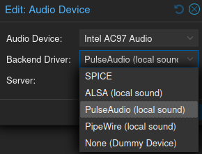
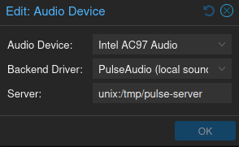

QEMU offers various audio devices and outputs to emulate sound hardware in virtual machines. This page outlines the available audio devices and configuration options for managing audio in QEMU. It supports both modern and older audio devices, ensuring compatibility with many guest operating systems. Additionally, QEMU supports network forwarding for remote audio configurations, allowing audio streams to be forwarded over a network connection.
The WSH PVE patches enable ALSA, PulseAudio and Pipewire with the configuration options outlined in this reference document.

## Audio Devices

The following audio devices are defined in the UI, and the existing Intel devices are fully named to make it easier to understand which driver should be used.

- **sb16**: Creative Sound Blaster 16 (ISA)
- **adlib**: Yamaha YM3812 (ISA)
- **pcspk**: PC Speaker
- **sb16-adlib-pcspk**: A combination of sb16, adlib, and pcspk with a single driver
- **cs4231**: Crystal CS4231, built into the SPARCstation 5 (SPARC 32-bit, machine SS-5 only; the
  only device offered there). Use it with `none`, `alsa`, `pa` or `pipewire`: SPICE needs a SPICE
  display, which SPARC doesn't have. See [Sound on the SS-5](/guides/sparc/#sound-on-the-ss-5).

## Backend driver (audio output)

The additional backend drivers support both local and remote audio output.

- **wav**: records to a file, for tests and recordings, not for listening. Not in the web UI's
  list; set it with `qm set <vmid> --audio0 device=<device>,driver=wav`. It works with every
  device above, the SS-5's `cs4231` included.
  - The file is always `/var/run/qemu-server/<vmid>-audio0.wav`. The path is fixed: `server=` can't
    change it, and a VM with `driver=wav` and a `server=` doesn't start. A fixed name in the VM's
    runtime directory means a VM config can't make QEMU (which runs as root) write anywhere else.
  - Each start overwrites the file. It stays after the VM stops, until the next start or the next
    reboot of the node.
  - `/var/run` is a tmpfs, so the recording is in RAM: QEMU's default format (44.1 kHz, 16-bit
    stereo) is about 10 MB per minute of sound. The file grows only while the guest plays: an idle
    VM leaves it at its 44-byte header. Copy the file away and switch the driver back when done.
  - The RIFF and data sizes in the header stay 0, even after a clean exit (guest power off,
    `qm stop`; measured with pve-qemu-kvm 11.1). Tools that trust the header see an empty file:
    read everything after the 44-byte header as the samples, or rewrite the header, for example
    with `sox --ignore-length <vmid>-audio0.wav fixed.wav`.
- **alsa**: ALSA (local sound)
- **pa**: PulseAudio (local sound)
- **pipewire**: PipeWire (local sound)

## Remote Audio Configuration

The audio server option enables configuring unix sockets for a local audio pipeline, or a remote host.

- server: the PulseAudio server, for driver `pa` only (default value `unix:/tmp/pulse-server`).
  With another driver it is ignored, with a warning in the start task's log; with `wav` the VM
  doesn't start.

A unix socket must already be configured and allow the context pveproxy is running under to connect to it.

Alternatively you can use the tcp, tcp4 or tcp6 protocol prefixes to connect to a remote machine, e.g. tcp:192.168.0.100:4713

## Further reading

- Read [about PulseAudio server strings](https://www.freedesktop.org/wiki/Software/PulseAudio/Documentation/User/ServerStrings/) in the official PulseAudio documentation.
- Read [about PulseAudio network setup](https://www.freedesktop.org/wiki/Software/PulseAudio/Documentation/User/Network/) in the official PulseAudio documentation.
