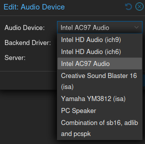

QEMU offers various audio devices and outputs to emulate sound hardware in virtual machines. This page outlines the available audio devices and configuration options for managing audio in QEMU. It supports both modern and older audio devices, ensuring compatibility with many guest operating systems. Additionally, QEMU supports network forwarding for remote audio configurations, allowing audio streams to be forwarded over a network connection.
The WSH PVE patches enable ALSA, PulseAudio and Pipewire with the configuration options outlined in this reference document.

## Audio Devices

The following audio devices are defined in the UI, and the existing Intel devices are fully named to make it easier to understand which driver should be used.

- **sb16**: Creative Sound Blaster 16 (ISA)
- **adlib**: Yamaha YM3812 (ISA)
- **pcspk**: PC Speaker
- **sb16-adlib-pcspk**: A combination of sb16, adlib, and pcspk with a single driver
- **cs4231**: Crystal CS4231, built into the SPARCstation 5 (SPARC 32-bit, machine SS-5 only; the
  only device offered there). Use it with `none`, `alsa`, `pa` or `pipewire`: SPICE needs a SPICE
  display, which SPARC doesn't have. See [Sound on the SS-5](/guides/sparc/#sound-on-the-ss-5).

## Which device works in which guest

Tested on x86 with the published packages by the [audio matrix](#how-this-is-tested): each guest
plays a known tone, QEMU's `wav` backend records it, and the recording must hold that tone. Every
row passed directly on QEMU and through qemu-server (`driver=wav`: `qm showcmd`, then a real
`qm start` whose recording holds the tone).

| `audio0: device=` | QEMU device | Guest tested | Result | Notes |
| --- | --- | --- | --- | --- |
| `sb16` | `sb16` (ISA) | DOS: own program, DSP 4.05, 8-bit PCM by DMA | plays | `BLASTER=A220 I5 D1 H5 T6`: QEMU's fixed defaults, qemu-server sets no resources. DMA playback only: direct DAC (DSP command `10h`) isn't emulated, so programs that play through it are silent. |
| `adlib` | `adlib` (ISA, OPL2) | DOS: own program, FM tone at 388h | plays | Also answers at 220h-223h and 228h-229h, where a real SB16 has its OPL3; QEMU's is an OPL2 (YM3812). Adlib's timer detection works. |
| `pcspk` | machine property `pcspk-audiodev` | DOS: PIT channel 2 through port 61h | plays | qemu-server only sets it for machine version 4.2 or newer; on an older pinned machine version the speaker is silent without an error. |
| `sb16-adlib-pcspk` | all three on one backend | DOS: the three tones in turn | plays | The usual choice for DOS games: digital sound, FM music and the speaker. |
| `AC97` | `AC97` (PCI, ICH AC'97 + STAC9700) | Linux `snd-intel8x0` | plays | Linux starts the mixer muted; a distribution's `alsactl init` or desktop unmutes it, a minimal system needs `amixer`. Windows 2000 and later have drivers. |
| `intel-hda` | `intel-hda` + `hda-micro` + `hda-duplex` | Linux `snd-hda-intel` (generic codec) | plays | Two codecs on one controller (as in stock Proxmox VE); Linux warns that their mixer controls exist twice. Mixer muted at start, as for AC97. Windows Vista and later. |
| `ich9-intel-hda` | `ich9-intel-hda` + the same codecs | Linux, machine q35 | plays | On q35 Proxmox VE's machine config already has an `ich9-intel-hda` **without codecs** at 00:1b.0, so the guest sees two controllers and `audio0` is the **second card**. Point the guest's default at it (Linux: `defaults.pcm.card 1`), or the first card stays silent. |
| `cs4231` | SPARCstation 5 only | | | Refused on x86. See [Sound on the SS-5](/guides/sparc/#sound-on-the-ss-5). |

In QEMU but not offered by qemu-server (would need `args:`):

| QEMU device | Guest tested | Result | Notes |
| --- | --- | --- | --- |
| `ES1370` (PCI) | Linux `snd-ens1370` | plays | The mixer isn't muted at start. Windows 9x/2000 drivers exist (Ensoniq AudioPCI). |
| `virtio-sound-pci` | Linux `virtio_snd` (5.13+) | plays | Modern Linux only. |
| `usb-audio` (with `qemu-xhci`) | Linux `snd-usb-audio` | plays | Needs a USB controller. |
| `gus` (ISA, Gravis Ultrasound GF1) | - | not tested | Port 240h, IRQ 7, DMA 3: IRQ 7 is LPT1's when the VM has a parallel port. |
| `cs4231a` (ISA, Windows Sound System) | - | not tested | Port 534h, IRQ 9, DMA 3: IRQ 9 is also `ne2k_isa`'s default, and DMA 3 is the GUS's. |
| `hda-output` | - | not tested | An output-only HDA codec. |

ISA resources at a glance (QEMU defaults, none settable through qemu-server): SB16 220h/IRQ 5/DMA
1 and 5, AdLib 388h, GUS 240h/IRQ 7/DMA 3, CS4231A 534h/IRQ 9/DMA 3, `ne2k_isa` 300h/IRQ 9. The
devices qemu-server offers don't conflict with each other or with `ne2k_isa`.

## Backend driver (audio output)

The additional backend drivers support both local and remote audio output.

- **wav**: records to a file, for tests and recordings, not for listening. Not in the web UI's
  list; set it with `qm set <vmid> --audio0 device=<device>,driver=wav`. It works with every
  device above, the SS-5's `cs4231` included.
  - The file is always `/var/run/qemu-server/<vmid>-audio0.wav`. The path is fixed: `server=` can't
    change it, and a VM with `driver=wav` and a `server=` doesn't start. A fixed name in the VM's
    runtime directory means a VM config can't make QEMU (which runs as root) write anywhere else.
  - Each start overwrites the file. It stays after the VM stops, until the next start or the next
    reboot of the node.
  - `/var/run` is a tmpfs, so the recording is in RAM: QEMU's default format (44.1 kHz, 16-bit
    stereo) is about 10 MB per minute of sound. The file grows only while the guest plays: an idle
    VM leaves it at its 44-byte header. Copy the file away and switch the driver back when done.
  - The header's two sizes stay 0, so tools that trust the header see an empty file. See
    [The wav file](#the-wav-file) for what is in it and how to read it.
- **alsa**: ALSA (local sound)
- **pa**: PulseAudio (local sound)
- **pipewire**: PipeWire (local sound)
- **dbus**: D-Bus, to the client of the VM's D-Bus display (a streaming server on the node). Needs
  `vga: ...,display=dbus` (or `mesa-display=dbus`); qemu-server adds `-audiodev dbus` and ties it
  to the display (`-display dbus,...,audiodev=dbus-backend0`). Tested with AC97 on x86 and the
  SS-5's CS4231 (`soundtest` of the wisp framebuffer kernels: 1 s of a 440 Hz tone reached the
  client's `AudioOutListener` from both). See the
  [display reference](/reference/display/#d-bus-display).

### The wav file

What `driver=wav` writes, measured with pve-qemu-kvm 11.1.3-3+wsh6 and qemu-server 9.2.20+wsh3
(through `qm start`) and on QEMU directly:

- **Format:** a 44-byte RIFF/WAVE header, then the samples. PCM (format tag 1), 2 channels,
  44100 Hz, 16-bit signed little-endian: 176400 bytes per second, 4 bytes per frame. These are
  QEMU's defaults for the `wav` audiodev; qemu-server doesn't set any, whatever the device plays
  (the SB16's 8-bit mono and the 22 kHz of a DOS game are converted to this).
- **Size:** about 10 MB per minute of sound. The file grows only while a device plays, so an idle
  guest leaves it at the 44-byte header.
- **The header's sizes are always 0.** QEMU fills in the RIFF size (offset 4) and the data size
  (offset 40) when the audio backend is shut down, and QEMU 11 never shuts it down at exit. The
  samples themselves are complete, however the VM ends:

| How the VM ends | QEMU's exit | RIFF / data size | Samples |
| --- | --- | --- | --- |
| The guest powers off | 0 | 0 / 0 | all |
| `qm stop` (QMP `quit`) | 0 | 0 / 0 | all up to the stop |
| SIGTERM | 0 | 0 / 0 | all up to the signal |
| SIGKILL | killed | 0 / 0 | up to the last 4 KB written (the rest was in QEMU's buffer) |

To read the file, take everything after byte 44 as 16-bit stereo samples at 44.1 kHz, or let a
tool ignore the header's length and write a fixed copy, for example
`sox --ignore-length <vmid>-audio0.wav fixed.wav`. The cause is QEMU's (since QEMU 11.0, also in
plain QEMU 11.1.3); it is written up for upstream in the repository's
`upstream/qemu-audio-wav-header-sizes.md`.

### Where the sound goes on a headless node

A Proxmox VE node usually has no speakers and nobody logged in, so the choice is where to send it:

- **`spice`** (the default): to the SPICE client (`remote-viewer`) of a VM with a SPICE display
  (`vga: qxl`). The web console (noVNC) carries no sound.
- **`none`**: the guest has its sound card and plays into nothing. Useful for guests that want a
  card to start, and what the tests use for `qm start`.
- **`pa` with `server=`**: a PulseAudio server elsewhere, for example
  `qm set <vmid> --audio0 device=sb16-adlib-pcspk,driver=pa,server=tcp:<desktop>:4713`, with
  `module-native-protocol-tcp` loaded there. A desktop running PipeWire answers too, through
  `pipewire-pulse` (the same protocol). This is the way to listen to a VM on a headless node.
- **`pa` without `server=`**, **`pipewire`**, **`alsa`**: the node's own sound server or card. On a
  headless node there usually is none; `pipewire` takes no `server=` (QEMU's PipeWire backend has
  no such option), so for a remote PipeWire desktop use `pa`.
- **`wav`** (QEMU's file recorder): what the tests use, `driver=wav` (see
  [above](#backend-driver-audio-output)). It records to a file on the node, so it is for checking
  that a guest makes sound, not for listening.

## Remote Audio Configuration

The audio server option enables configuring unix sockets for a local audio pipeline, or a remote host.

- server: the PulseAudio server, for driver `pa` only (default value `unix:/tmp/pulse-server`).
  With another driver it is ignored, with a warning in the start task's log; with `wav` the VM
  doesn't start.

A unix socket must already be configured and allow the context pveproxy is running under to connect to it.

Alternatively you can use the tcp, tcp4 or tcp6 protocol prefixes to connect to a remote machine, e.g. tcp:192.168.0.100:4713

## How this is tested

`e2e/audio/` in the repository, run by the `x86 audio matrix` workflow on GitHub-hosted runners
(weekly, on demand and on pull requests that touch it) against the published packages:

- **DOS**: FreeDOS 1.4's boot floppy (by URL and sha256; CI keeps the zip in the Actions cache) with its start-up files
  replaced, so it runs `AUDTEST.COM`, a small program written for the test (`audtest.asm`, built
  with nasm). It plays 1000 Hz on the SB16 (8-bit PCM by DMA), 440 Hz on the OPL2 and 750 Hz on the
  PC speaker, one after the other, then powers off through ACPI.
- **Linux**: Debian's kernel and an initramfs with busybox, `aplay` and one sound driver; it unmutes
  the mixer, plays a 660 Hz tone, reports on the serial console and powers off. No install.
- **The check**: the wav file must hold the expected tones (zero-crossing frequency within 4 %, RMS
  above -50 dBFS, at least 0.15 s) and no tone of a device that isn't attached, so
  `sb16-adlib-pcspk` must give all three and `sb16` only the 1000 Hz one.
- **Through Proxmox VE** (the e2e node in a container): a VM per `audio0` value with
  `driver=wav`. `qm showcmd` must have the expected `-device`/`-machine` arguments and the `wav`
  audiodev with the fixed path, and a real `qm start` must run the guest to its power off with the
  tones in `/var/run/qemu-server/<vmid>-audio0.wav`. One more VM checks that `driver=wav` with a
  `server=` doesn't start.
- **The wav header:** every recording must be in the [format above](#the-wav-file) with a
  consistent fmt chunk and whole frames, and its sizes must be right or 0. Four more cases end QEMU
  while the DOS guest plays: QMP `quit`, SIGTERM and SIGKILL on QEMU directly, and `qm stop`
  through Proxmox VE; each must leave a readable recording. When QEMU starts writing the sizes,
  the summary says "header sizes set" instead of "header sizes zero".

The results table is in the workflow's job summary; the recordings and logs are its artifact.

### The audio signature

Some tests play one fixed test signal instead of a single tone, made by the header
`e2e/wisp/audiosig.h` (integer arithmetic only, so a guest program without a C library can use it):

- 8 segments of 500 ms (4 s in all), 16-bit stereo, at any rate from 8000 to 48000 Hz;
- in segment k (0 to 7) a triangle wave of 400 + 100 k Hz on the left channel and 600 + 150 k Hz on
  the right: 400 to 1100 Hz on the left, 600 to 1650 Hz on the right, peak -6 dBFS.

`e2e/audio/wavcheck.py rec.wav --signature [N]` finds N of them in a recording of the `wav` driver
and checks each: every segment's frequency on each channel (within 3 %), the duration (4 s within
3 %), no quiet stretch over 2 ms on either channel, channels not swapped and not mono. Short
sound right after the end (old samples a DMA ring plays out after the stop) is reported as a tail;
more of the signal after a gap is a dropout. The signal is long enough to span many DMA buffers,
so a device that stops after the first buffer, or skips one, fails.

Played by:

- wisp's `soundtest sig` (`e2e/wisp/sound.py`, CI workflow `wisp-boot.yml`): at 8000, 22050 and
  44100 Hz through Linux's OSS emulation on pc and sun4u (AC97), virt (AC97) and the SS-5
  (CS4231). Lab, pve-qemu-kvm 11.1.3-4+wsh27: every segment within 0.01 % on all four, 4.000 to
  4.003 s, no gap.
- the 3dfx game wshspace's `-audiotest` (`e2e/3dfx/space`): on Linux through OSS with AC97
  (`audio-test.sh`, job in `audio-matrix.yml`), on DOS through its own Sound Blaster driver on the
  SB16, 8-bit stereo DMA at 22050 Hz (`e2e/3dfx/dos-test.sh`, `3dfx-dos.yml`). Both 4.000 s, no
  gap. The Windows build has it too but isn't run in a guest.

## Further reading

- Read [about PulseAudio server strings](https://www.freedesktop.org/wiki/Software/PulseAudio/Documentation/User/ServerStrings/) in the official PulseAudio documentation.
- Read [about PulseAudio network setup](https://www.freedesktop.org/wiki/Software/PulseAudio/Documentation/User/Network/) in the official PulseAudio documentation.
