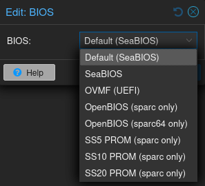

The BIOS (Basic Input/Output System) initializes and tests hardware components during the booting process of a virtual machine. This section provides an overview of the BIOS options available in QEMU and their configurations.

## BIOS options

x86_64 and aarch64 can both use OVMF BIOS. For aarch64 this requires the `AAVMF_CODE` firmware from `pve-edk2-firmware-aarch64`, which is pulled in automatically as a package dependency.

Sparc and sparc64 requires either the version of OpenBIOS that matches the architecture bits, or a PROM file.
Generally speaking OpenBIOS is more safe and easier to preconfigure and boot.
However nothing scratches that nostalgic itch quite like seeing the splash logo and POST from SparcStation 5.

The supported PROM files are `ss5.bin` (machine SS-5) and `ss20_v2.25_rom` (machine SS-20, which
also gets the `TI-SuperSparc-50` CPU it needs); `ss10_v2.25_rom` doesn't run on QEMU's SS-10 and isn't
offered. The BIOS selector only lists the firmware the chosen machine runs, see the
[SPARC guide](/guides/sparc/#supported-sparc32-profiles).

## Further reading

- Read [about OpenBIOS](https://github.com/openbios/openbios) in the official OpenBIOS documentation
