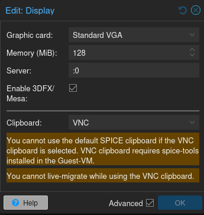

QEMU provides various display devices and options to emulate graphical output in virtual machines. This section outlines the available display devices and configuration options for managing graphical output in QEMU, ensuring compatibility with a wide range of guest operating systems and use cases.
The PVE WSH patches add graphic cards to the UI and adds support for X forwarding via GTK or GL, and an experimental 3DFX/Mesa passthrough option.

## Graphic card options

- tcx: TCX framebuffer (sparc only)
- cg3: CG3 framebuffer (sparc only), this is the preferred graphics card for sparc
- cirrus: Cirrus VGA - for MSDOS or other very old operating systems that can use a VESA1.2 compatible driver (but are too old to use generic SVGA/VESA2 - TODO: verify and add citation for the last part)


## Server

Unset by default, if it is set to an X display value such as :0 (or 192.168.0.100:0) it will force GTK or SDL output depending on the other options that are set.



## Enable 3DFX/Mesa

Experimental feature - it must be used in conjunction with the 3DFX/MESA drivers in Windows 9x/2000/ME.

Without a server, the Glide and OpenGL frames show in the VM's console (noVNC), rendered offscreen on the node; with a server they show in an SDL window on that X display.

See the [3DFX / Mesa passthrough guide](/guides/3dfx/) for how the host QEMU build and the guest drivers are paired by revision, and where to download the matching driver release.

## 3DFX/Mesa display

`mesa-display` picks the QEMU display a VM with 3DFX/Mesa enabled gets next to its VNC console:

- `none` (the default, **Default (read back)**): no `-display`; the Glide and OpenGL frames are read back into the console.
- `egl-headless` (**egl-headless (dmabuf)**): `-display egl-headless`, a display with GL that takes the Glide and OpenGL frames as a dmabuf and reads them into the console for VNC. It needs a GPU's render node or `/dev/udmabuf` on the node, and is slower than the default with Mesa's software renderer.

```sh
qm set 120 --vga std,mesa=1,mesa-display=egl-headless
```

In the web UI it is **Hardware > Display > 3DFX/Mesa display**, shown for x86 VMs while **Enable 3DFX/Mesa** is checked and the graphic card has a VNC console. Refused without `mesa=1`, with a `server` and with `none` or `serial*`; refused at start on a node with neither a render node nor `/dev/udmabuf`. When to use which and what the node needs: [Choosing the display](/guides/3dfx/#choosing-the-display-3dfxmesa-display).

## D-Bus display

`display=dbus` gives QEMU its D-Bus display (`-display dbus`) next to the VNC console: QEMU exports
the screen, the sound (with the audio driver `dbus`) and keyboard and mouse input over D-Bus, for a
client on the same node, such as a streaming server. The VNC console (noVNC) stays as it is.

```sh
qm set 130 --vga std,display=dbus
qm set 130 --vga std,display=dbus,dbus-refresh=14 --audio0 device=AC97,driver=dbus
qm set 120 --vga std,mesa=1,mesa-display=dbus   # 3DFX/Mesa: the D-Bus display with OpenGL
```

- **Its own bus.** QEMU owns the fixed name `org.qemu` on its bus, so each VM gets a bus of its own:
  qemu-server starts `wsh-dbus-display@<vmid>.service`, a `dbus-daemon`, before QEMU, and QEMU
  connects to `unix:path=/run/wsh-dbus-display/<vmid>.sock`
  (`-display dbus,addr=unix:path=...`). The stop (or the cleanup after QEMU exits) stops it and
  removes the socket. The directory is `root:wsh-display 0750` (the socket in it is `0777`, as
  dbus-daemon makes it), so only root and the group reach the socket; the bus's policy
  (`/usr/share/qemu-server/dbus-display.conf`) lets root own `org.qemu` and lets root and the
  members of the group `wsh-display` (created by the qemu-server package) connect and call it.
  Nobody else may connect. A client in a container gets the directory bind-mounted and a member of
  that group (as the host sees its user).
- **Without GL** (`display=dbus`) it works with every graphic card that has a picture: `std`,
  `cirrus`, `vmware`, `virtio`, and on sparc `tcx` and `cg3` (SS-5 and the other sparc32 machines)
  and sun4u's `std`. The client gets the console's pixels (`Scanout`/`Update`, or a shared memory
  map).
- **With GL** (`mesa-display=dbus`, the 3dfx binary): `-display dbus,gl=on`; the Glide and OpenGL
  frames reach the client as dmabufs, and the VNC console gets them read back (once per display
  refresh, by QEMU's own patch, as egl-headless does). It needs what egl-headless needs: a GPU's
  render node or `/dev/udmabuf`; see [Choosing the display](/guides/3dfx/#choosing-the-display-3dfxmesa-display).
- **`dbus-refresh`** (milliseconds, 1 to 1000): how often QEMU looks at the screen for changes and
  updates the client while one listens. QEMU's default is 30 ms, about 33 updates a second; 14
  suits a 70 Hz guest mode. A VGA's changes reach the client at most that often.
- **Sound**: `audio0: ...,driver=dbus` adds `-audiodev dbus` and ties it to the display
  (`audiodev=`); the client registers an `AudioOutListener` and gets the PCM.
- **The client goes or the bus goes**: QEMU keeps running when the client disconnects or is
  killed, and also when the `dbus-daemon` dies; the D-Bus display is then gone until the VM is
  restarted, while VNC goes on.

In the web UI it is **Hardware > Display > D-Bus display** and **D-Bus refresh (ms)**, and the audio
device's **Backend Driver > D-Bus**. Refused: `dbus-refresh` or the audio driver `dbus` without the
D-Bus display; the D-Bus display with a `server` (SDL), with `qxl*`, `virtio-gl`, `none` or
`serial*`, and together with `mesa-display=egl-headless` (QEMU has one display next to VNC).

To look at a running VM's bus as root:

```sh
busctl --address=unix:path=/run/wsh-dbus-display/130.sock tree org.qemu
```

## VGA retrace

`retrace=precise` (x86 only) switches QEMU to its precise VGA retrace emulation: reading the input
status register (port 3DAh) reports display enable and vertical retrace with the timing of a real
CRT. QEMU's default, `dumb`, flips both bits together on every read, so a program that waits for
several reads in a row of "display blanked, not in vertical retrace" (a horizontal blank) never sees
it. Wolfenstein 3D (and likely other id and Apogee games of its
time) then stays on a black mode-13h screen; see the [DOS guide](/guides/dos/#vga-retrace-games).

```sh
qm set 130 --vga std,retrace=precise
```

In the web UI it is **Hardware > Display > VGA retrace: Precise (DOS games)**, shown for x86 VMs with a
display type that has it.

- QEMU has no device property for it, only the `-vga` option, and it applies to every VGA device of
  the VM. qemu-server adds `-vga none,retrace=precise` (`none` adds no device) next to the usual
  `-device` (with a `server`, the `-vga` it already passes gets `,retrace=precise`).
- Accepted for the types whose QEMU device is built on QEMU's VGA core: `std` (`VGA`), `cirrus`
  (`cirrus-vga`), `vmware` (`vmware-svga`), `qxl*` (`qxl-vga`), `virtio` and `virtio-gl`
  (`virtio-vga`, `virtio-vga-gl`). Refused at create, update and start with `none`, `serial*`, the
  sparc `tcx` and `cg3`, and on other architectures.
- `retrace=dumb` is QEMU's default and adds nothing to the command line.

## Further reading

- Read [about SPARC platform graphics combinations](https://wiki.qemu.org/Documentation/Platforms/SPARC) in QEMU documentation
