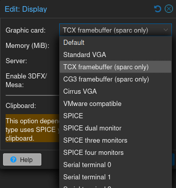

QEMU provides various display devices and options to emulate graphical output in virtual machines. This section outlines the available display devices and configuration options for managing graphical output in QEMU, ensuring compatibility with a wide range of guest operating systems and use cases.
The PVE WSH patches add graphic cards to the UI and adds support for X forwarding via GTK or GL, and an experimental 3DFX/Mesa passthrough option.

## Graphic card options

- tcx: TCX framebuffer (sparc only)
- cg3: CG3 framebuffer (sparc only), this is the preferred graphics card for sparc
- cirrus: Cirrus VGA - for MSDOS or other very old operating systems that can use a VESA1.2 compatible driver (but are too old to use generic SVGA/VESA2 - TODO: verify and add citation for the last part)



## Server

Unset by default, if it is set to an X display value such as :0 (or 192.168.0.100:0) it will force GTK or SDL output depending on the other options that are set.


## Enable 3DFX/Mesa

Experimental feature - it must be used in conjunction with the 3DFX/MESA drivers in Windows 9x/2000/ME.

Without a server, the Glide and OpenGL frames show in the VM's console (noVNC), rendered offscreen on the node; with a server they show in an SDL window on that X display.

See the [3DFX / Mesa passthrough guide](/guides/3dfx/) for how the host QEMU build and the guest drivers are paired by revision, and where to download the matching driver release.

## 3DFX/Mesa display

`mesa-display` picks the QEMU display a VM with 3DFX/Mesa enabled gets next to its VNC console:

- `none` (the default, **Default (read back)**): no `-display`; the Glide and OpenGL frames are read back into the console.
- `egl-headless` (**egl-headless (dmabuf)**): `-display egl-headless`, a display with GL that takes the Glide and OpenGL frames as a dmabuf and reads them into the console for VNC. It needs a GPU's render node or `/dev/udmabuf` on the node, and is slower than the default with Mesa's software renderer.

```sh
qm set 120 --vga std,mesa=1,mesa-display=egl-headless
```

In the web UI it is **Hardware > Display > 3DFX/Mesa display**, shown for x86 VMs while **Enable 3DFX/Mesa** is checked and the graphic card has a VNC console. Refused without `mesa=1`, with a `server` and with `none` or `serial*`; refused at start on a node with neither a render node nor `/dev/udmabuf`. When to use which and what the node needs: [Choosing the display](/guides/3dfx/#choosing-the-display-3dfxmesa-display).

## D-Bus display

`display=dbus` gives QEMU its D-Bus display (`-display dbus`) next to the VNC console: QEMU exports
the screen, the sound (with the audio driver `dbus`) and keyboard and mouse input over D-Bus, for a
client on the same node, such as a streaming server. The VNC console (noVNC) stays as it is.

```sh
qm set 130 --vga std,display=dbus
qm set 130 --vga std,display=dbus,dbus-refresh=14 --audio0 device=AC97,driver=dbus
qm set 120 --vga std,mesa=1,mesa-display=dbus   # 3DFX/Mesa: the D-Bus display with OpenGL
```

- **Its own bus.** QEMU owns the fixed name `org.qemu` on its bus, so each VM gets a bus of its own:
  qemu-server starts `wsh-dbus-display@<vmid>.service`, a `dbus-daemon`, before QEMU, and QEMU
  connects to `unix:path=/run/wsh-dbus-display/<vmid>.sock`
  (`-display dbus,addr=unix:path=...`). The stop (or the cleanup after QEMU exits) stops it and
  removes the socket. The directory is `root:wsh-display 0750` (the socket in it is `0777`, as
  dbus-daemon makes it), so only root and the group reach the socket; the bus's policy
  (`/usr/share/qemu-server/dbus-display.conf`) lets root own `org.qemu` and lets root and the
  members of the group `wsh-display` (created by the qemu-server package) connect and call it.
  Nobody else may connect. A client in a container gets the directory bind-mounted and a member of
  that group (as the host sees its user).
- **Without GL** (`display=dbus`) it works with every graphic card that has a picture: `std`,
  `cirrus`, `vmware`, `virtio`, and on sparc `tcx` and `cg3` (SS-5 and the other sparc32 machines)
  and sun4u's `std`. The client gets the console's pixels (`Scanout`/`Update`, or a shared memory
  map).
- **With GL** (`mesa-display=dbus`, the 3dfx binary): `-display dbus,gl=on`; the Glide and OpenGL
  frames reach the client as dmabufs, and the VNC console gets them read back (once per display
  refresh, by QEMU's own patch, as egl-headless does). It needs what egl-headless needs: a GPU's
  render node or `/dev/udmabuf`; see [Choosing the display](/guides/3dfx/#choosing-the-display-3dfxmesa-display).
- **`dbus-refresh`** (milliseconds, 1 to 1000): how often QEMU looks at the screen for changes and
  updates the client while one listens. QEMU's default is 30 ms, about 33 updates a second; 14
  suits a 70 Hz guest mode. A VGA's changes reach the client at most that often.
- **Sound**: `audio0: ...,driver=dbus` adds `-audiodev dbus` and ties it to the display
  (`audiodev=`); the client registers an `AudioOutListener` and gets the PCM.
- **The client goes or the bus goes**: QEMU keeps running when the client disconnects or is
  killed, and also when the `dbus-daemon` dies; the D-Bus display is then gone until the VM is
  restarted, while VNC goes on.

In the web UI it is **Hardware > Display > D-Bus display** and **D-Bus refresh (ms)**, and the audio
device's **Backend Driver > D-Bus**. Refused: `dbus-refresh` or the audio driver `dbus` without the
D-Bus display; the D-Bus display with a `server` (SDL), with `qxl*`, `virtio-gl`, `none` or
`serial*`, and together with `mesa-display=egl-headless` (QEMU has one display next to VNC).

To look at a running VM's bus as root:

```sh
busctl --address=unix:path=/run/wsh-dbus-display/130.sock tree org.qemu
```

## RDP (qemu-rdp)

The optional package `wsh-qemu-rdp` serves a VM's D-Bus display over RDP, with sound: any RDP
client (FreeRDP, Remmina, Windows' Remote Desktop Connection) gets the screen, keyboard, mouse and
the guest's audio through rdpsnd. It is [qemu-rdp](https://gitlab.com/marcandre.lureau/qemu-display)
from Marc-André Lureau's qemu-display project (IronRDP; RemoteFX and bitmap codecs, no H.264), at a
pinned commit with a few changes of ours (`packages/wsh-qemu-rdp` in wsh-pve). It is a stopgap
until the Moonlight streaming path; it needs no GPU.

```sh
apt install wsh-qemu-rdp
qm set 130 --vga std,display=dbus --audio0 device=AC97,driver=dbus   # sparc32 SS-5: cg3 and cs4231
systemctl enable --now wsh-qemu-rdp@130
cat /etc/wsh-qemu-rdp/130.conf                                        # address, port, user, password
```

- **One unit per VM.** `wsh-qemu-rdp@<vmid>.service` runs qemu-rdp on the VM's bus
  (`/run/wsh-dbus-display/<vmid>.sock`) as the user `wsh-qemu-rdp`, a member of `wsh-display`
  (the package creates both), with systemd's sandboxing. It is bound to the bus's unit
  `wsh-dbus-display@<vmid>`: enabled, it starts whenever qemu-server starts the bus (`qm start`) and
  stops with it (`qm stop`, and the cleanup after QEMU exits). `systemctl enable --now` starts it at
  once if the VM runs. The enablement is per node: after a migration, enable it on the new node.
  qemu-server isn't changed for it: the VM's `vga` needs only `display=dbus` (or `mesa-display=dbus`).
- **Configuration**: `/etc/wsh-qemu-rdp/<vmid>.conf` (root, `0600`), written at the first start and
  read at each start (`systemctl restart wsh-qemu-rdp@<vmid>` after a change):
  - `LISTEN` (default `127.0.0.1`) and `PORT` (default 20000 + VMID; set it for a VMID of 40000 or
    more). By default only the node itself can connect: use an SSH tunnel
    (`ssh -L 20130:127.0.0.1:20130 root@node`, then connect to `localhost:20130`), or set
    `LISTEN=0.0.0.0` to open it to the node's networks.
  - `RDP_USER` (`rdp`) and `RDP_PASSWORD` (24 random letters and digits, generated): the login.
  - `CERT` and `KEY`: a TLS certificate and key (PEM) of your own. Without them the node gets a
    self-signed certificate (RSA 3072, ten years, the node's host name) in `/var/lib/wsh-qemu-rdp`
    at the first start; its SHA-256 fingerprint is in the unit's journal, to compare with what the
    client shows the first time.
  - `LOG`: qemu-rdp's log level (`error`, `warn` by default, `info`, `debug`, `trace`), in the journal.
- **Authentication and encryption**: qemu-rdp offers only NLA (CredSSP, with NTLM, over TLS); the
  client must send the configured user name and password before it gets a picture, and a client
  without NLA (plain RDP or TLS-only security) is refused. One user name and password per VM; the
  domain is ignored. Without a password qemu-rdp would refuse every client, so the unit won't start
  without one. qemu-rdp has no other access control (no per-user accounts, no client certificates),
  hence the default of listening on the node only.
- **Sound**: with `audio0: ...,driver=dbus` the guest's playback goes to the client through rdpsnd,
  as Opus where the client offers it (FreeRDP does) or PCM, at 48 kHz: qemu-server gives the
  audio driver `dbus` `out.frequency=48000` and QEMU resamples the guest's rate to it (qemu-rdp
  passes QEMU's samples on unconverted and has only 48 kHz formats; at QEMU's default 44.1 kHz it
  dropped every buffer). Tested with AC97 on x86 and the SS-5's CS4231. No recording (the guest's
  microphone).
- **Mouse**: with an absolute pointer in the guest (PVE's default USB tablet, `tablet: 1`, or
  virtio's) the client's pointer positions are passed as they are. With only a relative mouse (a
  PS/2 mouse with `tablet: 0`, Windows 9x and DOS VMs, the SPARCstation's Sun mouse), the change
  from the last position is passed (our patch; upstream passed nothing then), and the guest's own
  pointer acceleration applies, so its pointer drifts from the client's as with VNC's relative mode.
  The buttons and the wheel work either way.
- **Resize**: when the guest changes its mode, the client's window follows (firmware text mode to
  the kernel's framebuffer, for instance). A client that asks for a size of its own (FreeRDP's
  `/dynamic-resolution`) passes it to QEMU as the display's size hint, which only a guest driver
  that reads it acts on (virtio-gpu's; not tested).
- **Speed**: in the tests (TCG, no GPU, client on the same node), a key typed in FreeRDP reached
  the guest's serial line in 15-17 ms, and a full-screen picture change reached the client's window
  within about 0.2 s; RemoteFX at that screen came through pixel for pixel.
- **Not there**: H.264/AVC (RemoteFX and bitmaps only, so a full-screen game moves a lot of data;
  fine on a LAN, heavy over the Internet), USB redirection (in newer qemu-rdp, from crates not on
  crates.io yet), audio recording, multiple monitors, the clipboard: the VM's bus lets QEMU answer
  calls but not call qemu-rdp's clipboard object (the policy allows method calls to `org.qemu`
  only), and QEMU would need a clipboard agent in the VM too.

To test a VM's server from the node itself (FreeRDP 3 from Debian, `freerdp3-x11`):

```sh
xfreerdp3 /v:127.0.0.1:20130 /u:rdp /p:"$(sed -n 's/^RDP_PASSWORD=//p' /etc/wsh-qemu-rdp/130.conf)" \
  /cert:tofu /sound
```

## Streaming sources (GStreamer)

The optional package `wsh-gst-qemu-dbus` has the pieces a streaming server on the node takes a VM's
D-Bus display from: two GStreamer sources and an input bridge (`packages/wsh-gst-qemu-dbus` in
wsh-pve). They are the first part of the Moonlight streaming path (stage 3 in the ROADMAP); the
server itself (Wolf, in a container on the node) isn't there yet. They need no GPU.

```sh
apt install wsh-gst-qemu-dbus gstreamer1.0-tools gstreamer1.0-plugins-base gstreamer1.0-plugins-good
qm set 130 --vga std,display=dbus --audio0 device=AC97,driver=dbus
gst-launch-1.0 qemudbussrc vmid=130 ! videoconvert ! autovideosink        # the picture
gst-launch-1.0 qemudbusaudiosrc vmid=130 ! audioconvert ! autoaudiosink   # the sound
qemu-dbus-input --vmid 130                                                 # input, one command per line
```

- **Who may**: root, or a member of `wsh-display` (the bus's policy, see [D-Bus display](#d-bus-display)).
  `vmid=` is short for `address=unix:path=/run/wsh-dbus-display/<vmid>.sock`; `console=` picks
  another console than 0. Each element registers its own listener, so they run next to each other,
  next to qemu-rdp and next to VNC.
- **`qemudbussrc`** gives raw video in the console's own format (`BGRx` for the usual 32-bit
  consoles, at the guest's resolution; a mode change renegotiates), one buffer per change of the
  picture, timestamped when it was taken (a live source with a variable frame rate: put `videorate`
  after it for a fixed one). Without GL it takes the console's surface through a shared memory map
  (or, with `shared-map=false`, the pixels in each update). With GL (`mesa-display=dbus`) QEMU hands
  it each frame as a dmabuf; it copies the changed part out and answers at once, since QEMU holds
  the guest's GL frames until the client answers (0.07-0.4 ms on average in the tests, single frames
  up to 14 ms on a busy host). It reads linear dmabufs only (Mesa's software renderer through `/dev/udmabuf`, which the
  tests use); a GPU's tiled dmabufs (NVIDIA's) aren't read yet: it warns and drops those frames.
  The mouse cursor isn't drawn into the picture. When the VM stops it ends the stream (EOS).
- **`qemudbusaudiosrc`** gives the guest's playback as raw PCM as QEMU sends it (48 kHz signed
  16-bit stereo with qemu-server's audio driver `dbus`), in 10 ms buffers. QEMU passes the guest
  mixer's volume and mute separately; the element applies them (`apply-volume=false` passes the
  samples as they are).
- **`qemu-dbus-input`** reads lines like `key 30 1` (Linux key code, press) and `key 30 0`
  (release), `btn left 1`, `wheel -1`, `rel 10 5` and `abs 640 400` (or `abs X Y W H`, scaled from a
  W x H client window), and sends them to the console's keyboard and mouse. QEMU takes absolute
  positions only from an absolute pointer in the guest (PVE's USB tablet, `tablet: 1`, or virtio's)
  and relative motion only from a relative one (PS/2 with `tablet: 0`, the Sun mouse); the bridge
  converts either to what the guest has, and says `mode absolute` or `mode relative`. `query` gives
  the mode and the console's size, `sync` waits for QEMU's answers. Keys still down when its input
  ends are released. `man qemu-dbus-input` has the whole protocol.
- **Tested** (`packages/wsh-gst-qemu-dbus/test.sh`, in CI; TCG, no GPU): wisp's framebuffer
  kernels on x86 (std VGA, PS/2, AC97), on aarch64's virt (virtio tablet, AC97), on the SS-5 (cg3,
  CS4231, Sun mouse) and on x86 with
  `dbus,gl=on`: the frame identical to QEMU's screendump, keys in the guest 5 ms after the bridge
  read them, relative and absolute motion and buttons, a 440 Hz tone of 2.00 s at 440.0 Hz, the end
  of stream when QEMU quits. Also through PVE (`qm start` of a `display=dbus` and a
  `mesa-display=dbus` VM).

## VGA retrace

`retrace=precise` (x86 only) switches QEMU to its precise VGA retrace emulation: reading the input
status register (port 3DAh) reports display enable and vertical retrace with the timing of a real
CRT. QEMU's default, `dumb`, flips both bits together on every read, so a program that waits for
several reads in a row of "display blanked, not in vertical retrace" (a horizontal blank) never sees
it. Wolfenstein 3D (and likely other id and Apogee games of its
time) then stays on a black mode-13h screen; see the [DOS guide](/guides/dos/#vga-retrace-games).

```sh
qm set 130 --vga std,retrace=precise
```

In the web UI it is **Hardware > Display > VGA retrace: Precise (DOS games)**, shown for x86 VMs with a
display type that has it.

- QEMU has no device property for it, only the `-vga` option, and it applies to every VGA device of
  the VM. qemu-server adds `-vga none,retrace=precise` (`none` adds no device) next to the usual
  `-device` (with a `server`, the `-vga` it already passes gets `,retrace=precise`).
- Accepted for the types whose QEMU device is built on QEMU's VGA core: `std` (`VGA`), `cirrus`
  (`cirrus-vga`), `vmware` (`vmware-svga`), `qxl*` (`qxl-vga`), `virtio` and `virtio-gl`
  (`virtio-vga`, `virtio-vga-gl`). Refused at create, update and start with `none`, `serial*`, the
  sparc `tcx` and `cg3`, and on other architectures.
- `retrace=dumb` is QEMU's default and adds nothing to the command line.

## Further reading

- Read [about SPARC platform graphics combinations](https://wiki.qemu.org/Documentation/Platforms/SPARC) in QEMU documentation
